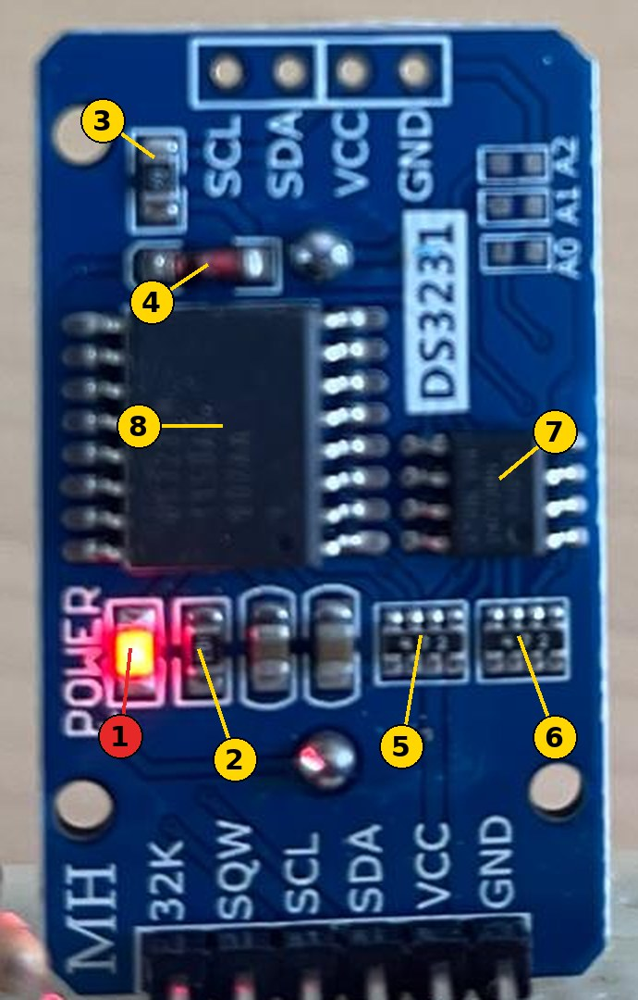

# The DS3231 Module {.unnumbered}

The most common DS3231 clock module, sold under the name ZS-042, is a blue board of 38 × 22 mm, with a holder for a CR2032 coin cell on its back, six pins on one side and four on the other. It was designed for an Arduino powered at 5 V. On the [outdoor station](../Outdoor/00-design.qmd#the-clock), which runs on a battery for months, it needs one change.

::: {.callout-important}
**One change only: remove the power LED.** Everything else on the module stays as it is.
:::

## What is on the module, and what to do with it

{width=350}

| # | Part | What it does | What to do |
|---|------|--------------|------------|
| 1 | **Power LED**, next to the word POWER | Lights as long as the module is powered | **Remove it** (see below) |
| 2 | Its **resistor**, 1 kΩ (marked 102) | Limits the current of the LED | Nothing: without the LED, no current flows |
| 3 | **Charging resistor**, 200 Ω (marked 201) | With the diode, charges a rechargeable coin cell from the supply | Nothing: at 3.3 V, it charges nothing (see [Why the charging circuit stays](#why-the-charging-circuit-stays)) |
| 4 | **Charging diode** | The other part of the charging circuit | Nothing |
| 5, 6 | **Resistor networks**, 4 × 4.7 kΩ each (marked 472) | Pull-up resistors: of the I2C bus and of the alarm (SQW), and of the address pins of the memory chip | Nothing: the bus and the alarm need them |
| 7 | **Memory chip** AT24C32 | Extra memory at the I2C address 0x57 | Nothing: the station does not use it |
| 8 | **DS3231** | The clock itself | Nothing |

The coin cell is on the back of the board. The six pins at the bottom of the photo (32K, SQW, SCL, SDA, VCC, GND) are those the station uses; the four at the top repeat the I2C bus and the power, to chain another module.

Sources: [Arduino forum](https://forum.arduino.cc/t/zs-042-ds3231-rtc-module/268862/1), [hackaday.io](https://hackaday.io/project/164645/log/186609).

## Removing the LED

1. **Find the LED**: power the module, from the bench station for example. The LED is the small part that lights, next to the word **POWER** printed on the board, close to the six pins (1 on the photo).
2. **Unpower the module**.
3. **Remove the LED** with the tip of the soldering iron: heat one of its two pads, then the other, and push the LED aside with the tip. Without a soldering iron, pushing it sideways with the tip of a small screwdriver also breaks it off its pads.
4. **Check**: power the module again. Nothing lights any more, and the clock works the same.

Removing its 1 kΩ resistor (2) instead has the same effect: the LED and its resistor are in series.

## How the module connects

The module connects with two Grove to female connectors cables (see [Connections](../Outdoor/00-design.qmd#connections)):

- **I2C**: from the hub of the sealed box, the red, black, yellow and white wires go onto the VCC, GND, SCL and SDA pins of the six-pin side;
- **Alarm**: from the D0/D1 connector of the Grove Shield, the yellow wire (D0) goes onto the **SQW** pin. The same cable also serves the **maintenance button**: its white wire (D1) and its black wire (GND) go to the button.

The ground of the alarm is that of the I2C cable: the SQW pin needs a single wire.

## Why the LED is removed

The LED draws current all the time. On the module of a hackaday.io project, removing the resistor of the LED lowered the current of the whole module **from about 1.9 mA to 0.3–0.5 mA** ([hackaday.io](https://hackaday.io/project/164645/log/186609)). For comparison, the XIAO ESP32-S3 sleeps with 14 µA: with its LED, the clock module alone would draw more than everything else.

## Why the charging circuit stays

The circuit was made for a LIR2032, the rechargeable version of the coin cell: it brings the supply voltage to the cell through its resistor and its diode. With a CR2032, which is not rechargeable, charging is a danger: a primary cell can leak, or swell. At 5 V, the circuit does charge the cell.

At 3.3 V, the supply of the station, the diode drops about 0.6 V: the cell sees about 2.7 V, less than its own 3 V, and no current flows into it ([hackaday.io](https://hackaday.io/project/164645/log/186609)). The circuit is then harmless. If the module may one day be powered at 5 V with a CR2032, removing the 200 Ω resistor disables the charge.

## Why the pull-up resistors stay

The I2C bus and the alarm output need pull-up resistors (see [Pull-Up and Pull-Down Resistors](01-pull-resistors.qmd)), and the network of the module provides them. Some projects cut it, and power the module only while they use it, to save its supply current. The station keeps the module powered all the time: the DS3231 then draws up to about 110 µA in standby, according to its [datasheet](https://www.analog.com/media/en/technical-documentation/data-sheets/DS3231.pdf). It is counted in the [energy of the outdoor station](../Outdoor/01-power.qmd#what-the-station-consumes).
