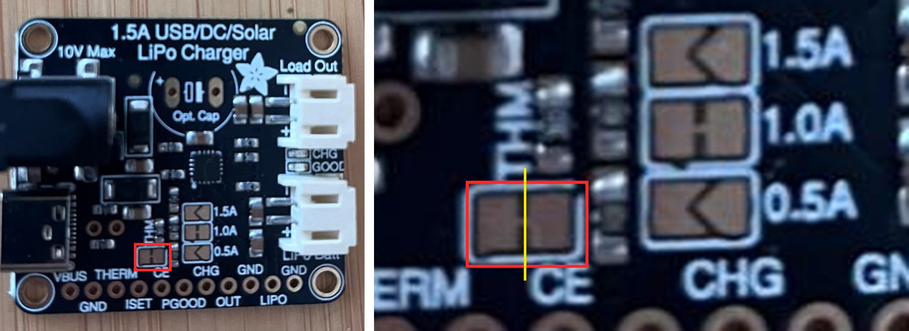

# The THERM Jumper of the bq24074 Charger {.unnumbered}

The solar charger of the [outdoor station](../Outdoor/01-power.qmd#the-charger), the Adafruit bq24074 board, only charges the battery between about +5 °C and +44 °C when a **thermistor** is taped against the battery: a resistor whose value goes down when the temperature goes up. The thermistor is not supplied with the board, and the board does not use it as delivered: one small copper track must first be cut. This appendix explains why, how to cut it, and how to check the cut with a multimeter.

## What the jumper does

The charger reads the temperature of the battery on its **THERM** pin. A 10 kΩ thermistor is worth 10 kΩ at 25 °C, more in the cold, less in the heat: the charger turns this value into a temperature.

Without a thermistor, the THERM pin would be connected to nothing, and the charger would refuse to charge. So the board connects it to the ground through a **fixed resistor of 10 kΩ**, mounted on the board ([board files of Adafruit](https://github.com/adafruit/Adafruit-BQ24074-PCB)): the charger always sees 10 kΩ, believes that the battery is at 25 °C, and charges whatever the weather.

This resistor is connected through a *solder jumper*: two small copper pads, joined by a thin track. Adafruit calls it the **THERM jumper**, and it is marked **THM** on the board. Its guide asks to cut it before a thermistor is connected ([Adafruit](https://learn.adafruit.com/adafruit-bq24074-universal-usb-dc-solar-charger-breakout/pinouts)).

## Why it must be cut

If the thermistor is soldered without cutting the jumper, the fixed resistor and the thermistor both connect the THERM pin to the ground, side by side: they are *in parallel*. The current goes through both, and the charger reads a single value, always lower than the lower of the two. It believes that the battery is warmer than it is.

With the thermistor of the station, whose *B* constant is 4300, calculated from this constant:

| Real temperature | Thermistor alone | With the fixed 10 kΩ next to it | What the charger believes |
|------------------|------------------|----------------------------------|---------------------------|
| 25 °C | 10 kΩ | 5 kΩ | about 40 °C |
| 0 °C | about 37 kΩ | about 7.9 kΩ | about 31 °C |

The second row is the danger: in the frost, the charger would believe that the battery is at 31 °C, and would charge it in the cold, which damages a lithium battery for good (see [Lithium and the cold](../Outdoor/01-power.qmd#lithium-and-the-cold)). The fixed resistor hides the cold from the charger: it is taken out of the circuit by cutting the jumper.

## Cutting the jumper

The jumper is on the top of the board, above the label **CE** of the row of pins, on the left of the three jumpers of the charge current, 1.5A, 1.0A and 0.5A, which stay as they are. It is a small square of copper, cut in two by a thin gap: the two pads, left and right, are joined in the middle by a tiny track.

1. Light the board from the side. The zoom of a phone camera, set to ×2 or ×3, shows the jumper much larger.
2. Pass the tip of a cutter in the gap between the two pads, across the track in the middle, several times, lightly, rather than once with force.
3. Check the cut with the multimeter, as described below. If the track still connects the pads, pass the cutter again at the same place.

Staying between the two pads, the cutter touches nothing else.

## Checking with a multimeter

A multimeter offers two tests that look alike:

- the **continuity tester**, which beeps: it answers the question "is it a wire?", and only beeps for a very low resistance, a few tens of ohms on most multimeters. A wire or a solder joint, below 1 Ω, beeps; a resistor of 10 kΩ, although it connects the two pins, does not;
- the **resistance range**, marked Ω: it gives the value, here on the 20 kΩ range.

The check uses the resistance range, between the **THERM** pin and the **GND** pin right next to it, before and after the cut.

On our board, before the cut, the multimeter read **7.29 kΩ**, and **9.95 kΩ** with its two probes swapped. The multimeter measures by sending a small current from one probe to the other. In one direction, this current also flows through the chip of the charger, which lets it through in that direction only, like a diode: two paths at once, and a lower value. In the other direction, the chip blocks it, and the multimeter reads the resistor alone: 9.95 kΩ, the 10 kΩ of the resistor within its tolerance.

After the cut, in the direction that read 9.95 kΩ, the multimeter showed **OL**, for *over limit*: the resistance is beyond what the range can measure, almost no current flows, and the fixed resistor is out of the circuit. A value of 0, shown as 0.00, would mean the opposite: a direct link, a short circuit.

## Soldering the thermistor

The thermistor has no polarity: either leg goes to either pin.

1. Cut two wires of 15 to 20 cm, for example from two jumper wires or from a spare Grove to female connectors cable, and strip their ends: the legs of the thermistor are too short to reach the charger, which stays a few centimetres away from the battery so that its heat does not warm it.
2. Solder one wire to the **THERM** pin, the other to the **GND** pin next to it.
3. Slide a piece of heat-shrink tubing on each wire, solder the other ends to the two legs of the thermistor, then slide the tubing over the joints and shrink it: the two legs must never touch.
4. Measure again between THERM and GND, in the same direction as before: the multimeter now reads the thermistor, about 10 to 13 kΩ at a room temperature of 20 to 25 °C, and the value goes down when the thermistor is warmed between two fingers.
5. Hold the thermistor against the battery with a piece of adhesive tape.
