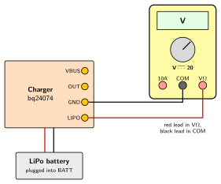
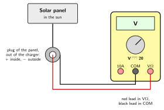
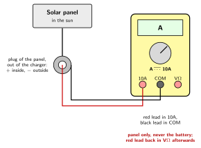
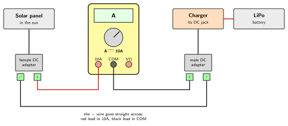

# Checking the Panel and the Battery with a Multimeter {.unnumbered}

The [battery monitor](../Outdoor/01-power.qmd#the-battery-monitor) of the outdoor station reports the voltage and the current of the battery at each wake-up. A multimeter checks the power by hand: when the station is installed, when a value looks wrong, or to know what the panel gives under the sky of the day. This appendix explains how to connect it for each check, and how to read the result.

## The multimeter

A multimeter measures, among other things, a **voltage**, in volts (V), and a **current**, in amperes (A). Its dial chooses what it measures, and its *range*: the largest value it can show. On a manual-range multimeter, such as the Lexman LX-M-1000 used for this book, the range is chosen just above the expected value: the 20 V range for a battery of 4.2 V.

The panel and the battery give a **direct current**, which always flows in the same direction. Its ranges are marked with a straight line, often above a dotted one: V⎓ and A⎓. The ranges marked with a wave, V~, are for the alternating current of the mains, and are not used here.

The two test leads plug into **jacks**:

- **COM**, the common jack: the black lead, always;
- **VΩ**: the red lead, to measure a voltage or a resistance;
- **10A**: the red lead, to measure a current up to 10 A.

Multimeters also have ranges for small currents, in milliamperes (mA) and microamperes (µA). Their input is protected by a fuse of a few hundred milliamperes, which the current of the panel, about half an ampere, would blow. The checks of this appendix only use the 10A jack.

## Voltmeter and ammeter

The multimeter is connected in two different ways, depending on what it measures.

**As a voltmeter**, it measures the difference of voltage between two points: one probe on each point, *in parallel* with what is measured. It lets almost no current through: it disturbs nothing, and it can touch anything powered.

**As an ammeter**, it measures the current that flows through it: the circuit is opened, and the multimeter takes the place of the missing wire, *in series*. All the current goes through it, and it lets it through as easily as a wire.

The danger comes from this last point. An ammeter placed in parallel, across the + and the − of a source, joins them like a wire: it makes a **short circuit**. A solar panel can only give its maximum current, about half an ampere here: the short circuit does it no harm, and is even a way to measure this current. A lithium battery gives several amperes into a short circuit: the wires and the multimeter heat up, and the battery can catch fire.

::: {.callout-warning}
## Two rules

1. **The 10A jack is only used on the panel**: never on the battery, nor on the pads of the charger.
2. **After a current measurement, the red lead goes back into the VΩ jack**, and the dial back to the volts, right away: the next measurement, on the battery, would otherwise be a short circuit.
:::

## The voltage of the battery

The voltage of a lithium battery tells its state of charge. The battery stays plugged into the charger: the multimeter reads it on two **pads** of the charger, the small holes ringed with copper along the edge of the board, each with its name printed next to it.

1. Open the sealed box.
2. Set the dial on the **20 V range of the direct voltage** (V⎓). Red lead in **VΩ**, black lead in **COM**.
3. Hold each probe by its handle, and touch the **GND** pad with the black probe, then the **LIPO** pad with the red probe. Each probe touches a single pad: a probe that touches two pads at once joins them.
4. Read the voltage.

| Voltage | State of the battery |
|---|---|
| 4.2 V | full |
| about 3.7 V | about half |
| about 3.3 V | almost empty |
| about 3.0 V | empty: its protection disconnects it |

While the sun charges the battery, the charger raises its voltage: the reading is higher than the real state of charge. The true state is read when the charger does not charge, at dusk or at night, or half an hour after the plug of the panel was taken out of the charger.

A value with a minus sign, such as −3.95 V, means that the probes are swapped: the value itself is right.

## The voltage of the panel

This check tells whether the panel and its cable work. The plug of the panel is taken out of the charger: the station keeps running on its battery.

1. Leave the panel in its place, in the light, and take its plug out of the DC jack of the charger.
2. Set the dial on the **20 V range of the direct voltage** (V⎓). Red lead in **VΩ**, black lead in **COM**.
3. Push the red probe into the hole of the plug, against its inner contact, the +; hold the black probe against the metal sleeve around the plug, the −.
4. Read the voltage, then put the plug back into the charger.

Without anything drawing current from it, a panel gives more than its rated voltage: around 8 V for a 6 V panel in the sun. Under clouds, the voltage stays at several volts: the voltage of a panel depends little on the light, and says nothing about the energy it gives. Its current does.

- **0 V**: no contact; the cable or the plug is broken.
- **A minus sign**: the + of the plug is on the outside. The charger expects it inside: the plug of the panel does not suit it.

## The current of the panel

### The short-circuit current

The multimeter, as an ammeter, joins the two contacts of the plug: the panel gives all the current it can under the light of the moment, its **short-circuit current**. In full sun, it shows what the panel can give; on another day, the comparison tells how much light reaches it.

1. Take the plug of the panel out of the charger.
2. Set the dial on the **10 A range of the direct current** (A⎓). Red lead in **10A**, black lead in **COM**.
3. Touch the plug as for its voltage: red probe in the hole, black probe on the sleeve. Read the current within a few seconds.
4. Move the red lead back into **VΩ**, and the dial back to the volts. Put the plug back into the charger.

A 3 W panel of 6 V gives a little more than 0.5 A in full sun, facing the sun; lying flat, less, and much less in winter. Under a thick grey sky, it gives a few tens of milliamperes, shown as 0.02 or 0.03 on the 10 A range, which counts in hundredths of an ampere. In full sun, a current much lower than expected points to shade, dirt on the panel, or a damaged panel.

### The current that charges the battery

The short-circuit current is what the panel *can* give. The current that the charger *takes* from it is measured with the multimeter in series on the + wire, between the panel and the charger. The cable of the panel is not cut: two **DC adapters** open it, one female, which receives the plug of the panel, and one male, which goes into the charger, each with two screw terminals, + and −. Sold in pairs for LED strips, in the 5.5 × 2.1 mm size of the plug, they cost a few euros.

1. Set the dial on the **10 A range of the direct current** (A⎓). Red lead in **10A**, black lead in **COM**.
2. Join the − terminals of the two adapters with a wire.
3. Screw the red lead into the + terminal of the female adapter, and the black lead into the + terminal of the male adapter. The current comes from the panel into the red lead, crosses the multimeter, and leaves by the black lead towards the charger.
4. Plug the panel into the female adapter, then the male adapter into the charger, and read the current.
5. Take the adapters out, put the plug of the panel back into the charger, then move the red lead back into **VΩ** and the dial back to the volts.

The current depends on the battery as much as on the sun. While the battery charges, the charger takes up to what the panel gives, and its **CHG** light is on. Once the battery is full, the charger stops charging, and the panel only gives what the station draws, a fraction of a milliampere on average: the 10 A range shows 0.00, too coarse to see it.

The current of the battery itself, in and out, is the job of the battery monitor: measuring it with the multimeter would mean opening the wire of the battery, which the station never does (see [Wiring](../Outdoor/01-power.qmd#wiring)).

## What the readings tell

| Check | Expected | Otherwise |
|---|---|---|
| Battery voltage, at night | 3.3 to 4.2 V | Below 3.3 V, the battery is almost empty: the panel does not charge it enough. |
| Panel voltage, out of the charger | around 8 V in the sun | 0 V: the cable or the plug is broken. A minus sign: the plug does not suit the charger. |
| Short-circuit current of the panel | a little more than 0.5 A in full sun, facing it | Much lower in full sun: shade, dirt, or a damaged panel. |
| Charge current | up to the short-circuit current while CHG is on | 0.00 in the sun, CHG off, and the battery not full: the charger pauses the charge, often because the battery is out of +5 to +44 °C (see [the charger](../Outdoor/01-power.qmd#the-charger)). |
