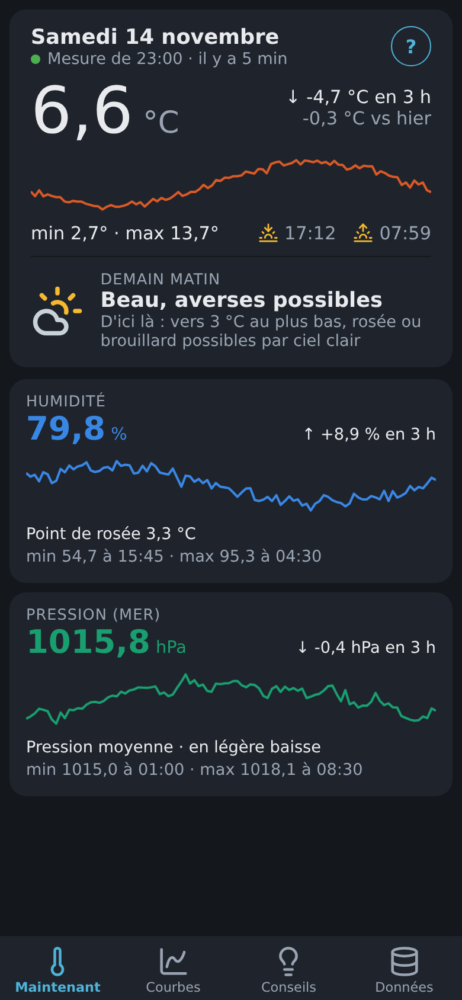
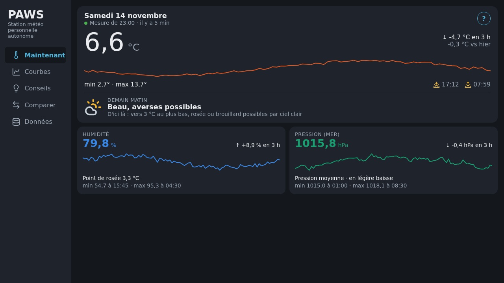
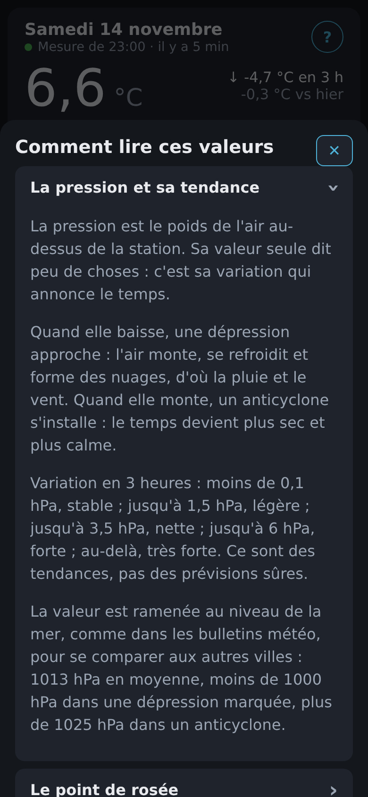

# B2 · Now {.unnumbered}

Step B1 stores the data of the station on the server. Step B2 shows it in a dashboard, opened in a browser on a computer or a phone of the home network. The dashboard has five tabs, one per chapter of B2:

- **Maintenant** (Now), this chapter: the weather of the moment, and the forecast of the next hours;
- **Courbes** (Graphs): the curves of temperature, humidity and pressure, from a few hours to several years;
- **Conseils** (Advice): what to wear, whether to hang out the laundry, whether to water the garden;
- **Comparer** (Compare): two days, weeks, months or years drawn over each other;
- **Données** (Data): the export of the measurements, the last backup, and the files of the station sent by hand.

This chapter builds the page itself, then its first tab: the last measurement and the health of the station (BF3 · Dashboard, BF4 · Health of the station), and the values the backend computes from the measurements.

> **Ready-to-use project:** The complete code of this step is available in the repository here: [`backend/paws`](https://github.com/wg1d/personal-autonomous-weather-station/tree/v1.0.0/backend/paws)

## The page

The dashboard is written in French: it is used every day at home, by people who read French. The book, like the code, stays in English; the screenshots show the French page.

{width=300}

On a phone, the tabs sit in a bar at the bottom of the screen, within reach of the thumb, each with an icon above its name. On a computer, they sit in a panel on the left:



The Compare tab draws two periods side by side in time: it needs the width of a computer, and is left out of the bar of a phone.

The page has a single dark theme. It is read in the evening as often as in the day, and a dark page does not dazzle; the colors of the curves are chosen to stay distinct for the most common forms of color blindness.

The dashboard is served by the backend itself, on the same port as the API: `http://192.168.1.28:8080` (the address of the server) opens it; `/` sends the browser to `/dashboard/`.

## Dash

[Dash](https://dash.plotly.com/) builds web pages in Python. A Dash application has two parts:

- **the layout**: the elements of the page, written as Python objects, such as `html.Div(...)` for a block of the page, `dcc.RadioItems` for the tabs, or `dcc.Graph` for the graphs. Dash turns them into HTML in the browser;
- **the callbacks**: Python functions that Dash calls when an element changes in the browser, such as a click on a tab. They receive the values of some elements (the *inputs*), and return new values for others (the *outputs*).

Dash runs on Flask, an older kind of Python web application, called *WSGI*; FastAPI is an *ASGI* application, its newer version. The `a2wsgi` package lets FastAPI serve the Dash application under `/dashboard`, so that the API and the dashboard share one service and one port (BN2 · Light). `main.py` also reads the place of the station from the environment: its altitude, for the pressure at sea level, and its latitude and longitude, for the sun (see [Setting the Station Location](../Appendix/08-station-location.qmd)):

```{.python include="../../_versions/v1.0.0/backend/paws/paws_server/main.py"}
```

## The Now tab

From the top to the bottom:

- **A red warning**, only when the station is silent: after 2 hours without a new row, a red band appears at the top of the page, for example "Aucune nouvelle mesure depuis 3 h 05 min : vérifiez la station." The station uploads every hour: 2 hours without data mean that it missed an upload.
- **A blue warning**, only when it freezes, or may freeze in the night (see [Frost](#frost)).
- **The summary**, on the top card:
  - today, and the time of the last measurement with a dot, green while the station sends its data, red when it is silent; the station measures every 15 minutes, so the page shows the last measurement, not the weather of this very second;
  - the temperature in large, with its change over 3 hours and the difference with yesterday at the same time on its right;
  - the feels-like temperature, only in the heat, when it differs from the temperature;
  - a small curve of the last 24 hours;
  - the minimum and maximum of the day, and the times of the sunrise and the sunset; after the sunset, the sunset of today and the sunrise of tomorrow;
  - the forecast of the barometer, with an icon, the part of the day it covers, and the dew or the fog to expect.
- **The Humidity and Pressure tiles**, laid out alike: the value, its change over 3 hours, a small curve of the last 24 hours, one line that tells what the value means, and the minimum and maximum of the day.
- **The help button** `?`, at the top right, opens a sheet that explains how to read each value, in blocks closed until clicked:

{width=300}

The page follows a simple rule: **the tiles tell the present, the forecast tells what comes next.** The Pressure tile says that the pressure is high and falls slowly, not that it will rain; the forecast, at the bottom of the top card, says it.

While the page is open, it asks for new data every 5 minutes.

## The computed values

The sensor measures three quantities: the temperature, the relative humidity and the pressure. The backend computes others from them, which tell more about the weather felt and the weather to come. They are computed in `weather.py`:

- **The dew point**: the temperature at which the air, cooled down, would be saturated with water. Below it, the water condenses: dew on the grass, frost below 0 °C, fog in the air. It is computed with the Magnus formula, and the constants of Sonntag (1990), precise to about 0.1 °C between −45 °C and 60 °C.
- **The feels-like temperature in the heat**: humid air slows down the evaporation of sweat, and the body feels hotter than the air. It is the *heat index* of the US National Weather Service, computed with the [formula of Rothfusz](https://www.wpc.ncep.noaa.gov/html/heatindex_equation.shtml) (NWS Technical Attachment SR 90-23, 1990), which the weather service only uses for a heat index from about 80 °F, 27 °C. The dashboard computes it from 27 °C and 40 % of humidity: below, the air feels about as warm as it is (our limit). In the cold, the felt temperature depends on the wind, which the station does not measure: it is then not computed.
- **The absolute humidity**: the mass of water vapour in a cubic metre of air, in grams, whatever the temperature. The pressure of the vapour, from the Magnus formula, is turned into a mass with the law of ideal gases.
- **The vapour pressure deficit**: how much more water the air could hold, in kilopascals (kPa): the force with which it draws water from plants, soil or laundry. It is the pressure of the vapour of saturated air, from the formula of Tetens used by the [FAO](https://www.fao.org/4/x0490e/x0490e07.htm) for the water needs of crops, minus the pressure of the vapour the air holds. The Advice tab uses it.
- **The pressure at sea level**: the pressure the station would measure at the altitude 0. Weather maps and forecasts give it, so that places at different altitudes can be compared: near the ground, the pressure falls by about 1 hPa every 8 metres. The formula is the one of the standard atmosphere of the [ICAO](https://en.wikipedia.org/wiki/International_Standard_Atmosphere), with 15 °C at sea level.
- **The forecast of the barometer**: the Zambretti method, explained in the [Barometer Forecast](02-6-barometer-forecast.qmd) chapter.

Each function returns `None` when a measurement it needs is missing.

```{.python include="../../_versions/v1.0.0/backend/paws/paws_server/weather.py"}
```

These values are not stored: the database keeps only what the station measured. SQLite computes them when the dashboard reads the rows: `database.py` gives the functions of `weather.py` to SQLite (`create_function()`), and the queries call them like functions of SQL. A better formula only needs a new version of the backend: the old measurements then get the new values too.

## Reading the values

Each line of the Now tab comes from a rule, and each rule from a source, or from an estimate of ours, said as such.

**The change over 3 hours.** The weather services give the change of the pressure over 3 hours, its *tendency*: the tiles give the change of each quantity over the same time, from the last row at least 3 hours older than the last measurement (`trend()`). A change that rounds to 0 is written "stable".

**The pressure.** The words of its change follow the *pressure tendency* of the station reports of the [Met Office](https://weather.metoffice.gov.uk/guides/coast-and-sea/glossary), the weather service of the United Kingdom, over the 3 preceding hours. The Met Office starts its scale at 0.1 hPa: below, the tile writes "stable".

| Change in 3 hours | Met Office | On the tile |
|-------------------|------------|-------------|
| less than 0.1 hPa | (below its scale) | stable |
| 0.1 to 1.5 hPa | rising or falling slowly | en légère hausse / baisse |
| 1.6 to 3.5 hPa | rising or falling | en hausse / baisse |
| 3.6 to 6.0 hPa | rising or falling quickly | en forte hausse / baisse |
| more than 6.0 hPa | rising or falling very rapidly | en très forte hausse / baisse |

The level of the pressure is said low below 1006 hPa, and high above 1020 hPa: the mean pressure at sea level is 1013.25 hPa in the standard atmosphere; the two limits, 7 hPa below and above it, are our estimate.

**The humidity.** A relative humidity of 90 % on a cold night holds little water: cold air saturates quickly. The dew point says how much water the air really holds, and how it feels: under 10 °C, the air is dry; from 10 to 16 °C, comfortable; from 16 to 20 °C, a bit heavy; above 20 °C, oppressive. These limits are rounded from the usual tables of comfort, such as the one of the [dew point article of Wikipedia](https://en.wikipedia.org/wiki/Dew_point#Relationship_to_human_comfort): an estimate. The tile only writes the word from 16 °C: "dry air" next to a humidity of 90 % reads as a mistake.

**The forecast.** The Zambretti method looks about 12 hours ahead. Rather than an hour ("until 08:00"), the title names the part of the day it covers, from the hour the page is read:

| The page is read | The title |
|------------------|-----------|
| from midnight to 6:00 | Ce matin (this morning) |
| from 6:00 to noon | Cet après-midi (this afternoon) |
| from noon to 18:00 | Ce soir et cette nuit (this evening and night) |
| from 18:00 to midnight | Demain matin (tomorrow morning) |

Below the text of the forecast:

- **the rain**, only when the text does not already speak of it: "Pluie peu probable" under "Beau temps", nothing more under "Beau, averses possibles". A fall of the pressure of more than 3.5 hPa in 3 hours, which the Met Office calls a quick fall, makes rain probable, whatever the text;
- **the night**, from noon to 6:00: on a clear and calm night, the air seldom cools much below its dew point, where its water condenses and gives back heat. The line gives the dew point as the lowest temperature to expect, with dew, frost or fog "possible on a clear night"; "probable" when the air is already within 2 °C of its dew point. This is a rule of thumb of the forecasters, an estimate: clouds and wind keep the night warmer, and the station measures neither. In the morning, a line appears only when the air is nearly saturated.

The icon of the sky comes with each of the 32 forecasts of the method: a sun, a sun and a cloud, a cloud with rain, a cloud with lightning. They are icons of the [Lucide](https://lucide.dev) set, colored for this page: the sun in yellow, the cloud in grey, the rain in the blue of the humidity.

**The sun.** `sky.py` computes the sunrise and the sunset from the date and the position of the station, with the *sunrise equation*: the position of the Earth on its orbit gives the declination of the sun, how far north or south of the equator it stands, then the angle the Earth turns between the sunrise and noon at this latitude. The sun rises when its top edge appears: its centre is then 0.833° below the horizon, its radius plus the bending of light by the air. The result is precise to about a minute.

```{.python include="../../_versions/v1.0.0/backend/paws/paws_server/sky.py"}
```

`sky.py` also computes the phase of the moon. The page no longer shows it: it said nothing about the weather.

### Frost

The ground, and the plants on it, cool down faster than the air measured at the height of the shelter: on a clear night, they may freeze while the shelter still reads 2 or 3 °C. The blue warning appears:

- when the temperature is at or below 0 °C: "Il gèle";
- in the evening and the night (from 16:00 to 9:00), when the temperature is at or below 3 °C, or when it is at or below 6 °C with a dew point at or below 1 °C: "Gelée possible".

These limits are our estimate, from the rule of the night above: the air of the night goes down towards its dew point.

## The code

`dashboard.py` holds the whole page, in parts that follow its tabs. The Now tab uses these functions:

- `health()` computes the age of the last row and decides whether the station is silent (more than 2 hours);
- `trend()`, `day_extremes()` and `yesterday_text()` give the change over 3 hours, the minimum and maximum of the day, and the difference with yesterday;
- `pressure_state()` and `humidity_state()` write the line of meaning of each tile;
- `forecast()` returns the title, the text, the icon and the details of the forecast; `dew_outlook()` writes the line of the night;
- `sun_events()` gives the sunrise and the sunset to show; `frost_advice()` the frost warning;
- `sparkline()` draws a small curve as an SVG image: a text that describes the line, which the browser draws at any size, without any file;
- `hero()` builds the top card, and `tiles()` the tiles.

`build_view()` gathers everything the page shows, from the database and the current time: the tests call it directly, without a browser. The callback `update()` calls it when the page opens and every 5 minutes. The help sheet opens and closes in the browser itself, with a small function in JavaScript (a *clientside callback*): there is nothing to ask the server.

::: {.callout-note collapse="true"}
## dashboard.py

```{.python include="../../_versions/v1.0.0/backend/paws/paws_server/dashboard.py"}
```
:::

## The style

The colors, sizes and layout of the page are in a style sheet, `assets/style.css`. Dash adds every file of the `assets` folder to the page, next to the application.

The icons are drawings of the Lucide set (ISC licence), copied in `assets/icons` so that the page works without internet. Most are used as a *stencil* (a CSS mask), painted with the color of the text: the icon of the tab shown turns to the color of the accent with its name. The icons of the forecast keep their own colors: they are shown as images.

The rules inside `@media (max-width: 600px)` only apply to a narrow screen, such as a phone: the panel becomes the bar at the bottom, and the tiles go one above the other.

::: {.callout-note collapse="true"}
## style.css

```{.css include="../../_versions/v1.0.0/backend/paws/paws_server/assets/style.css"}
```
:::

## The tests

The tests of the dashboard, in `test_dashboard.py`, call its functions directly. For the Now tab, they check:

- **the health**: no data, a recent row, a row older than 2 hours;
- **the computed values**: the dew point, the feels-like temperature only in the heat, the pressure at sea level (in `test_weather.py`);
- **the lines of the tiles**: the change over 3 hours, the scale of the Met Office for the pressure, the dew point and its comfort word;
- **the forecast**: the title for each part of the day, the icon, the rain line only when the text does not speak of rain, the line of the night;
- **the sun**: the sunrise and the sunset of a known day in Paris (in `test_sky.py`), and the sunrise of tomorrow only after the sunset;
- **the frost**: a warning when it freezes, and on a cool and dry evening; none at noon, nor on a mild and humid evening.

The dashboard shows local time, which depends on the computer running the tests. The fixture `utc_local_time` sets the local time to UTC during each test: the results are the same on any computer, and in the CI.

## Trying it with made-up data

Without the station, the database of the development computer is empty. A small script fills a database with three years of made-up measurements, one every 15 minutes: the temperature follows the seasons and the hours of the day, the humidity goes the other way, and the pressure drifts slowly, as weather systems pass.

::: {.callout-note collapse="true"}
## make_test_data.py

```{.python include="../../_versions/v1.0.0/backend/paws/dev/make_test_data.py"}
```
:::

From the root of the repository, this command makes the data again, then starts the backend on it:

```bash
pixi run backend-demo
```

and the dashboard opens at `http://localhost:8080`. Without a position, the page shows no sunrise or sunset; the screenshots of this chapter give it the centre of Paris:

```bash
PAWS_LATITUDE=48.853 PAWS_LONGITUDE=2.349 PAWS_ALTITUDE_M=35 pixi run backend-demo
```

The made-up data lives in `backend/paws/dev/data`, ignored by git, and never reaches the server.

## On the server

The dashboard is deployed like the rest of the backend:

```bash
pixi run deploy-backend
```

## Troubleshooting

| Symptom | Cause and fix |
|---------|---------------|
| The page stays white | The browser cannot load the scripts of the page: reload it. If it stays white, `journalctl -u paws-backend -n 50` on the server shows the errors of the callbacks. |
| The dot is red after a deployment | The deployment does not change the data: the station has not uploaded for 2 hours. Check its log on the maintenance page, or `station.log` on the server. |
| No sunrise or sunset | The position of the station is missing from `~/paws/station.env` (see [Setting the Station Location](../Appendix/08-station-location.qmd)). |
| The pressure at sea level equals the measured pressure | The altitude is missing from `~/paws/station.env`. |
| No forecast | The forecast needs the change of the pressure over 3 hours: it appears 3 hours after the first measurements. |
| The times are one or two hours off | The server is not set to the local time zone: `timedatectl` on the server shows it, `sudo timedatectl set-timezone Europe/Paris` sets it. |

## Next Steps

The [next chapter](02-2-graphs.qmd) describes the Courbes tab: the graphs of the three quantities, from a few hours to several years.
