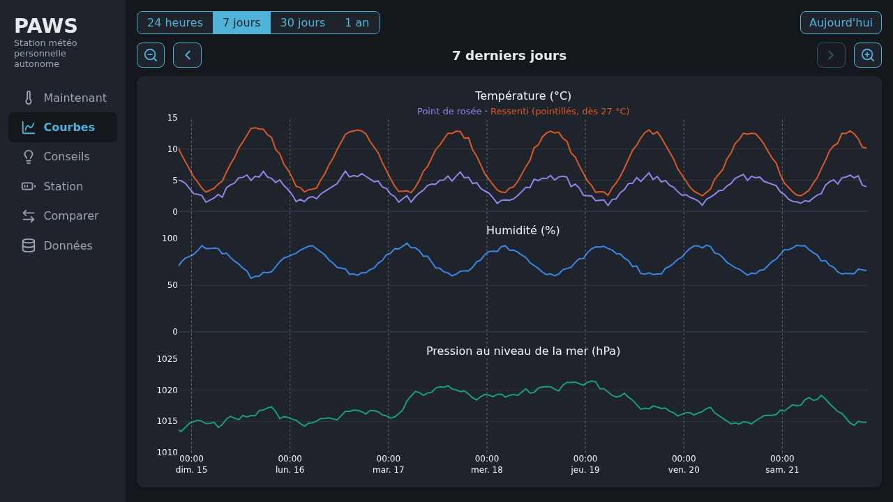
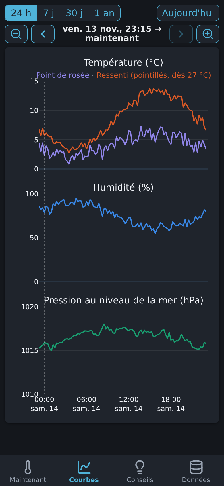
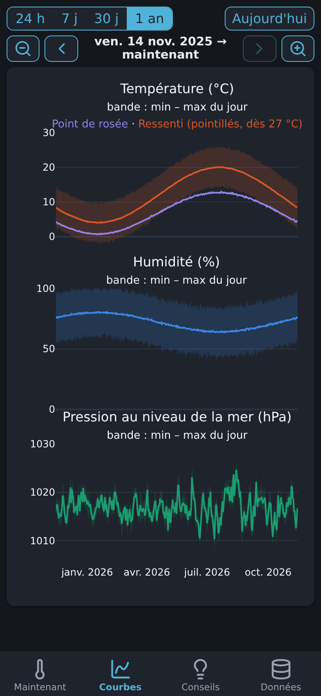

# B2 · Graphs {.unnumbered}

The [first chapter of B2](02-1-now.qmd) builds the page and its Now tab. The second tab, **Courbes** (Graphs), draws the temperature, the humidity and the pressure over a chosen period, from a few hours to several years (BF3 · Dashboard): to see the day that just passed, the weather systems of a week, or the seasons.

> **Ready-to-use project:** The complete code of this step is available in the repository here: [`backend/paws`](https://github.com/wg1d/personal-autonomous-weather-station/tree/v1.2.1/backend/paws)

## The tab



From the top to the bottom:

- **The period**: 24 heures, 7 jours, 30 jours or 1 an, and **Aujourd'hui** (today), which comes back to the present.
- **The steps**: zoom out, the period before, the period shown, the period after, zoom in. While the graphs show the present, there is no period after.

The title of the period fits on one line on a phone (`period_title()`). While the graphs show the present, it is written in words: "Dernières 24 h", "7 derniers jours", "30 derniers jours", "12 derniers mois", or "Dernières 12 h" after a zoom. In the past, it gives the start and the end, with the hours up to 2 days ("13 nov. 23:15 → 14 nov. 23:15", cut before its arrow), the days up to 2 months ("7 → 14 nov."), the months beyond ("nov. 2025 → nov. 2026"). The exact time of each point is in the bubble of the graphs.
- **The graphs**, one per quantity, one above the other, sharing the same time axis. A dotted line marks each midnight. The graph of the temperature also draws two computed values (see [the computed values](02-1-now.qmd#the-computed-values)): the dew point in violet, and in the heat, the feels-like temperature, dotted.

To move in time, **drag the graphs** to the left or to the right: the three graphs move together. **The mouse wheel** zooms in or out in time, around the mouse; on a phone, which cannot zoom the graphs with two fingers, the zoom buttons do it. Neither goes beyond the data: not after the present, and not before the oldest row once the graphs were dragged.

The points depend on the length shown: every row up to 2 days, the average of each hour up to 3 months, then the minimum, average and maximum of each day, drawn as the average inside a band that goes from the minimum to the maximum. Each graph then says it: "bande : min – max du jour". The screen shows no more detail, and the page stays light.

On a phone, the controls are smaller, and the periods are written in short (24 h, 7 j, 30 j, 1 an), so that the graphs and their time axis fit on the screen:

::: {layout-ncol=2}
{width=280}

{width=280}
:::

## A scale that stays still

Each graph has its own value axis: the temperature in °C, the humidity in %, the pressure in hPa. Plotly, the library that draws the graphs, can choose the limits of an axis by itself, from the values it is given. The graphs are given more than the period shown (see [the navigation](#the-dashboard)): its own choice would follow values that are not on the screen, and change at each move. The pressure of a calm day, between 1012 and 1014 hPa, was drawn squeezed at the top of a scale from 1000 to 1015 hPa.

The dashboard chooses the limits itself (`value_range()`): the lowest and highest values of the period shown only, rounded down and up to steps of 5 °C and 5 hPa. The same day of pressure is drawn between 1010 and 1015 hPa. The scale stays still while the graphs are dragged, and only changes, once they are released, when the values cross a multiple of 5. The humidity always goes from 0 to 100 %: a percentage has its own limits.

## A young station

A period that ends now is shown whole, even when it starts before the first measurement: the year of a station started a few weeks ago shows its 12 months, empty until the first measurement, and its few weeks at the right. Once dragged, the graphs stop at the oldest row.

## The queries

The graphs read the database with these functions of `database.py`:

```{.python include="../../_versions/v1.2.1/backend/paws/paws_server/database.py"}
```

- **`last_row()`** gives the last measurement, for the Now tab and the health of the station.
- **`first_local_time()`** gives the time of the oldest row: the graphs cannot go before it once dragged.
- **`rows_between()`** gives the rows of a period, up to 2 days. SQLite also gives the time of each row in the local time of the server (`datetime(timestamp, 'localtime')`): the database stores UTC, but the graphs show the time of the house.
- **`hourly_summary()`** gives the average of each hour, up to 3 months, placed at the middle of the hour.
- **`daily_summary()`** gives the minimum, average and maximum of each day, beyond 3 months.

Each summary is a single SQL query: `GROUP BY` gathers the rows of the same hour or day, and `MIN()`, `AVG()` and `MAX()` compute their values. A missing value (`NULL`) is ignored by these functions. The computed values, such as the dew point, are computed by SQLite in the same query, from the functions of `weather.py` (see [the computed values](02-1-now.qmd#the-computed-values)).

Only the rows with a valid time (`time_valid = 1`) are shown: a row measured while the clock was not reliable may carry a wrong date, such as `2000-01-01`.

The days of `daily_summary()` are days in UTC: the first ten characters of the timestamp, its date. In France, such a day starts at 1:00 or 2:00 in the night instead of midnight, which changes little to its minimum, average and maximum. Grouping the rows by local day would need to convert each of them first: for three years of rows, it takes 6 seconds on the server, against 1.5 seconds in UTC.

## The dashboard

The Graphs tab is a part of `dashboard.py`, shown in the [first chapter](02-1-now.qmd#the-code).

**Navigation in time.** The page keeps the period shown in a `dcc.Store`, a value kept in the browser, without anything on the screen: its length, and its end, which is `None` while the page shows the present. `shown()` computes the start and the end of the period from it.

The drag and the zoom are done by Plotly itself, in the browser (`"dragmode": "pan"` and the `scrollZoom` option). After each move, Plotly tells the page the new limits of the time axes (`relayoutData`): `shown_limits()` reads them, and `view_after_move()` turns them into the new period shown. The page then loads the data around the new position, at the resolution of the new length (`resolution()`).

To show the data right away while the graphs are dragged, they hold more than the period shown: as much again on each side. The data beyond appears once the mouse is released.

The limits of the data are given to the time axes (`"minallowed"` and `"maxallowed"`): Plotly stops a drag or a zoom at them. At a limit, Plotly stops the edge that reached it, and lets the other one move on: the graphs then show a shorter period.

**Graphs.** `figure()` builds the three graphs; given another list of quantities, it draws the graphs of the battery of the Station tab the same way. A Plotly figure is a dictionary, in the format that the JavaScript library reads in the browser:

- `"data"` holds the curves: for each one, its points (`"x"`, `"y"`), its color, and its axes;
- `"layout"` holds everything around them: the axes and their limits, the titles, the dotted lines (`"shapes"`) and the colors.

Plotly names the axes `x`, `x2`, `x3` and `y`, `y2`, `y3`. Each graph has its own value axis, placed by its `"domain"`, the part of the height of the figure it takes, and fixed by `"fixedrange"`: a drag only moves the time. The three time axes are linked (`"matches": "x"`): moving one moves the others.

Over a year, each quantity has three curves: the minimum, drawn without a line, then the maximum, filled down to the previous curve (`"fill": "tonexty"`), which draws the band between them, then the average.

**The callbacks.**

- `navigate()` is called on a click on a period, an arrow, a zoom button or Aujourd'hui, or after a drag or a zoom; `ctx.triggered_id` tells which element changed. It returns the new period shown;
- `update_graphs()` reads the database and returns the figures and the title of the period, of the Courbes tab and of the [Station tab](02-7-station.qmd), which shows the same period. It only computes the graphs, not the rest of the page: a drag stays quick on the server.

::: {.callout-tip collapse="true"}
## Python: `**` in a dictionary, and formats in f-strings

`{"type": "scatter", **axes}` copies all the keys of the dictionary `axes` into the new dictionary: here, `"xaxis"` and `"yaxis"`, which are the same for the curves of one graph.

In an f-string, what follows `:` inside the braces is a *format*: `f"{value:.1f}"` writes a number with one decimal, and `f"{moment:%H:%M}"` writes a time, such as `14:45`, with the codes of `strftime()`. The names of the days and months come from the system in English: `french_date()` writes them in French.
:::

## Speed on the server

The first version of the dashboard, in v0.9.0, built its figure with the figure objects of Plotly (`plotly.graph_objects`), which check every value they receive. On the development computer, the page was fast. On the server, with three years of made-up data, we measured how long the server took to answer:

| Period | Figure objects of Plotly | Dictionary |
|--------|--------------------------|------------|
| 24 hours | 2.7 s | 0.14 s |
| 7 days | 16 s | 0.5 s |
| 30 days | 69 s | 1.1 s |

A 30-day view with its margins held about 8,600 rows: the figure objects checked each of their 26,000 values, and the dotted lines one by one, on a processor much slower than the one of the development computer. Written as a dictionary, the figure is sent as it is: Plotly checks it in the browser anyway. The local time of each row is also given by SQLite, three times faster than Python on the server.

The averages of each hour and of each day then cut the number of points. With the code of v0.9.0, the server built each view in 0.02 s (24 hours), 0.06 s (7 days), 0.23 s (30 days) and 1.2 s (1 year), with three years of data.

Measuring on the real server, and with realistic amounts of data, showed the problem; the development computer hid it.

## The tests

The tests of the Graphs tab, in `test_dashboard.py`, check:

- **the navigation**: the period ends now by default; the limits that Plotly reports for its three time axes are read; a drag or a zoom sets the period shown, and coming back to the present follows the new data again; the resolution follows the length shown;
- **the queries**: the rows outside the period and those with an invalid time are left out; the averages of each hour, and the minimum, average and maximum of each day, ignore the missing values;
- **the view**: one curve per quantity over a day, with the dew point and the feels-like temperature; three over a year (minimum, band, average); the margin on each side; the limits of the data on the three time axes;
- **the scale**: rounded to steps of 5, from the period shown only, not from the margins; 0 to 100 % for the humidity;
- **a young station**: its year is shown whole until the graphs are dragged.

## Troubleshooting

| Symptom | Cause and fix |
|---------|---------------|
| The graphs are empty | No row in the period shown: press **Aujourd'hui**, or choose a longer period. Rows written while the clock was not reliable (`time_valid = 0`) are never shown. |
| The graphs shrink when dragged | They reached the oldest row or the present: Plotly stops that edge, and the other one moves on. Press a period button to show its length again. |
| A long straight line crosses a gap | The station sent nothing for a while: the points on each side of the gap are joined by a line. The rows sent later from the maintenance page, through the [Data](02-5-data.qmd) tab, fill it. |
| The year view is mostly empty | The station is young: the year is shown whole, empty before the first measurement. |

## Next Steps

The [next chapter](02-3-advice.qmd) describes the Conseils tab: what to wear, whether to hang out the laundry, whether to water the garden, all read from the measurements.
