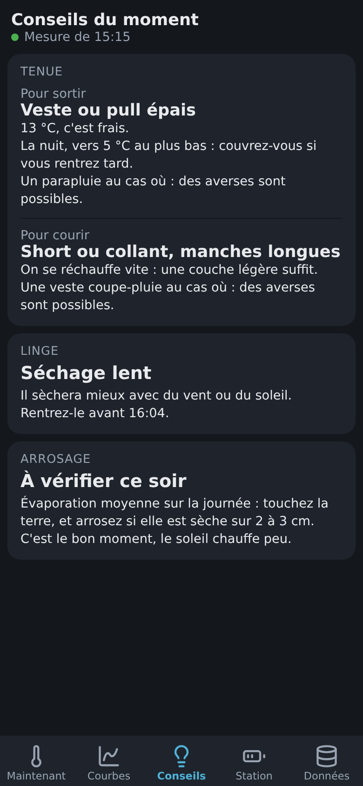

# B2 · Advice for the Day {.unnumbered}

The measurements of the station answer questions of every day: what to wear to go out, or to go running? Can the laundry dry outside? Does the garden need water? The third tab of the dashboard, **Conseils** (Advice), answers them, each in a tile, with the reason of its answer.

The advice used to sit on the Now tab, below the weather. It made the page long, and mixed the weather with what to do about it: it has a tab of its own.

> **Ready-to-use project:** The complete code of this step is available in the repository here: [`backend/paws`](https://github.com/wg1d/personal-autonomous-weather-station/tree/v1.1.0/backend/paws)

## The tab

{width=300}

At the top, the title **Conseils du moment**, with the time of the measurement the advice reads and the dot of the Now tab: the advice reads the last measurement of the air, and the line says when the air sensor stopped answering. Then three tiles:

- **Tenue** (clothes): what to wear to go out, then, below a thin line, what to wear to run, each part under a small title, *Pour sortir* and *Pour courir*. Each part gives the clothes in bold, then why: the temperature and what it feels like, what the forecast means for the clothes, and only when they matter, the umbrella, the cap, the light at night.
- **Linge** (laundry): whether laundry dries outside now, and when to hang it out or bring it in.
- **Arrosage** (watering): whether the garden needs water, and the good moment to water it.

The station measures neither the wind, nor the sun, nor the rain, nor the soil. Each tile says what it cannot know: the advice reads the air, and the reader checks the rest.

**Most limits of this chapter are estimates of ours**, chosen to give sensible advice in a garden of the south-west of France; the tables below say which. They are constants at the top of their part of `dashboard.py`, easy to change.

## The rain

Three tiles speak of rain: the umbrella, the rain jacket, the laundry to bring in. They read it from the barometer (`rain_expected()`):

- **probable** when the pressure at sea level falls by more than 3.5 hPa in 3 hours, which the Met Office calls a quick fall (see [the pressure](02-1-now.qmd#reading-the-values)), or when the [forecast of the barometer](02-6-barometer-forecast.qmd) speaks of rain, showers or storm;
- **possible** when the forecast says they are possible, such as "Beau, averses possibles".

The station has no rain gauge: it cannot tell whether it rained, only whether the barometer announces it.

## What to wear

**To go out**, the clothes follow the temperature felt: the feels-like temperature in the heat, the temperature of the air otherwise (see [the computed values](02-1-now.qmd#the-computed-values)). Below each limit:

| Temperature felt | Clothes | Why, on the tile |
|------------------|---------|------------------|
| below 0 °C | Manteau, bonnet et gants (coat, hat and gloves) | il gèle : couvrez la tête, les mains et le cou |
| 0 to 8 °C | Manteau et écharpe (coat and scarf) | il fait froid : couvrez-vous bien |
| 8 to 14 °C | Veste ou pull épais (jacket or thick sweater) | c'est frais |
| 14 to 19 °C | Pull léger ou veste légère (light sweater or jacket) | c'est doux |
| 19 to 25 °C | Tee-shirt | il fait bon |
| 25 °C and more | Tenue légère et claire (light clothes, in pale colors) | il fait chaud : buvez souvent |

The limits are our estimate. The wind makes the cold feel stronger, and the station does not measure it: on a windy day, one more layer. From 22 °C, in the day, the tile adds a cap against the sun (our estimate); when rain is probable or possible, an umbrella.

The clothes follow the temperature of the moment, and the [forecast](02-6-barometer-forecast.qmd), on the Now tab, may announce a fair afternoon: "11 °C, c'est frais" next to "Cet après-midi : beau" would read as a contradiction. A line repeats what the forecast means for the clothes (`forecast_note()`):

- under "Cet après-midi", when the sky of the forecast is fair: "Cet après-midi, beau temps : prévoyez une couche à retirer" (plan a layer to take off);
- in the evening, the lowest temperature of the night, the same as the line of the forecast: "La nuit, vers 5 °C au plus bas : couvrez-vous si vous rentrez tard".

The station forecasts no temperature for the afternoon: the line only repeats the forecast, without a figure of its own.

**To run**, the body warms up with the effort, but not at once: at the start, the air feels as cold for a runner as for anyone. A runner wears about **one layer less** than to go out. An earlier version dressed the runner as if it were 10 °C warmer, a rule often given to runners: at 9 °C, it advised shorts and a T-shirt next to a jacket to go out, which read as a contradiction, and felt too light at the start. The clothes now follow the air:

| Air | Clothes | Why, on the tile |
|-----|---------|------------------|
| below 0 °C | Collant, veste, bonnet et gants (tights, jacket, hat and gloves) | il gèle : couvrez la tête et les mains, même en courant |
| 0 to 5 °C | Collant, manches longues et gants (tights, long sleeves and gloves) | il fait froid : on se réchauffe vite, mais pas tout de suite |
| 5 to 10 °C | Collant et manches longues (tights and long sleeves) | c'est frais : une couche de moins que pour sortir |
| 10 to 15 °C | Short ou collant, manches longues (shorts or tights, long sleeves) | on se réchauffe vite : une couche légère suffit |
| 15 to 22 °C | Short et tee-shirt (shorts and T-shirt) | pas besoin de se couvrir pour courir |
| 22 °C and more | Short et débardeur (shorts and vest) | le plus léger possible, et de l'eau |

These limits are our estimate.

From a feels-like temperature of 30 °C, the body cools down badly in the effort: the tile says "Trop chaud" (too hot), and advises to run early in the morning, and to drink (our limit). At night, between the sunset and the sunrise, it adds a head torch or a reflective vest; when rain is probable or possible, a rain jacket.

The temperature is written once, in the part to go out: the part to run says only what it means for a runner. Without these sentences, "Manteau" to go out and "Short et tee-shirt" to run, side by side, read as a contradiction.

## The laundry

Laundry dries when the air takes its water. How much more water the air can take is its **vapour pressure deficit** (see [the computed values](02-1-now.qmd#the-computed-values)): the larger it is, the faster the laundry dries. The relative humidity alone does not tell it: at 80 % of humidity, air at 30 °C dries much faster than air at 5 °C.

The tile answers, in this order, the first question that applies:

1. **Does the pressure fall fast?** Rain is probable: "À rentrer" (bring it in).
2. **Is it night?** From the sunset to the sunrise, the air cools and its humidity rises: laundry left outside gets wet. The tile tells when to hang it out the next morning.
3. **Is the sunset less than an hour away?** Same reason: "À rentrer", before the air cools.
4. **Is the air nearly saturated**, within 2 °C of its dew point? The laundry no longer dries, and the dew will wet it: "À rentrer".
5. Otherwise, **the deficit of the moment**:

| Vapour pressure deficit | On the tile |
|-------------------------|-------------|
| below 0.4 kPa | Pas de séchage: the air is too humid |
| 0.4 to 1.0 kPa | Séchage lent: it dries better with wind or sun |
| 1.0 kPa and more | Bon séchage: it dries fast |

The limits of the deficit, and the hours, are our estimates. In the morning, until 2 hours after the sunrise, the dew of the night evaporates first: the tile says the laundry will dry better after that hour. Later, it says to bring it in an hour before the sunset. The wind and the sun dry laundry too, and the station measures neither: a windy, sunny day dries better than the tile says.

## The watering

Plants draw water from the soil, and lose it through their leaves: the drier the air, the more they lose. The tile reads the highest vapour pressure deficit of the last 24 hours: how dry the air was at its driest.

| Highest deficit of the day | On the tile |
|----------------------------|-------------|
| below 0.6 kPa | Pas nécessaire: the plants lost little water; and do not wet the leaves, humidity favours their diseases |
| 0.6 to 1.2 kPa | À vérifier: touch the soil, and water if it is dry 2 to 3 cm deep |
| 1.2 kPa and more | Conseillé: the soil dries fast; water at the foot of the plants if it is dry |

Greenhouse growers keep the deficit between about 0.8 and 1.2 kPa for most crops: below 0.4 kPa, the plants hardly transpire and fungal diseases spread; above 1.6 kPa, they close their pores to keep their water. The limits of the tile follow these orders of magnitude; for a garden, they are our estimate.

Then the good moment: in the morning, until 3 hours after the sunrise, or in the evening, from 2 hours before the sunset. In the heat of the day, the water evaporates before it reaches the roots. These hours are our estimate, from the usual advice of gardeners to water in the cool of the morning or the evening. When the pressure falls fast, the tile adds that the rain might water in its place.

The station measures neither the rain nor the soil: the tile tells when watering is useful, if the soil is dry. Touching the soil, with a finger, remains the test.

## The code

The Advice tab is a part of `dashboard.py`, shown in the [first chapter](02-1-now.qmd#the-code):

- `rain_expected()` reads the rain from the barometer;
- `clothes_advice()` and `running_advice()` return the clothes and their reasons, as a list of sentences that only holds the ones that apply; `outfit_tile()` builds the Tenue tile, the two parts split by a thin line;
- `laundry_advice()` and `watering_advice()` return a headline and a detail; `watering_moment()` gives the good moment to water;
- `forecast_note()` writes the line of the forecast for the clothes;
- `advice_tiles()` builds the tab, called by `build_now()`.

The limits are constants at the top of each part: `CLOTHES`, `RUNNING_CLOTHES`, `DRYING_SLOW_KPA`, `WATERING_LOW_VPD`, and the others. Each function takes the local time and the times of the sun as parameters, rather than reading the clock: the tests can ask for any hour.

## The tests

The tests of the Advice tab, in `test_dashboard.py`, check:

- **the clothes**: the clothes and their reason below the limits; the heat index counts more than the air; a cap in the sun of a warm day, not at night; an umbrella when the pressure falls fast, and "au cas où" when showers are only possible;
- **the running**: at 9 °C, one layer less than to go out, not shorts; a light at night; "Trop chaud" in the heat;
- **the forecast**: a fair afternoon gives a layer to take off, the evening the lowest temperature of the night, a rainy afternoon no line;
- **the laundry**: a fast or a slow drying from the deficit; the saturated air and a fast fall of the pressure, whatever the deficit; the night, the hour to hang it out, and the hour to bring it in;
- **the watering**: the highest deficit of the day, not the last one; the good moment, from the hour and the sun.

## Troubleshooting

| Symptom | Cause and fix |
|---------|---------------|
| The advice gives no hour | The position of the station is missing from `~/paws/station.env`: without the sunrise and the sunset, the tiles cannot place the morning and the evening (see [Setting the Station Location](../Appendix/08-station-location.qmd)). |
| The watering says "Pas nécessaire" after a dry day | The highest deficit of the last 24 hours stayed below 0.6 kPa: a cool and humid day, even without rain. Touch the soil all the same. |
| The laundry says "Séchage lent" on a windy day | The station does not measure the wind, which dries laundry too. |
| The clothes feel too light on a windy day | Same cause: the wind makes the cold feel stronger. Add a layer. |

## Next Steps

The [next chapter](02-7-station.qmd) describes the Station tab: the battery of the station, and the problems told by its log.
