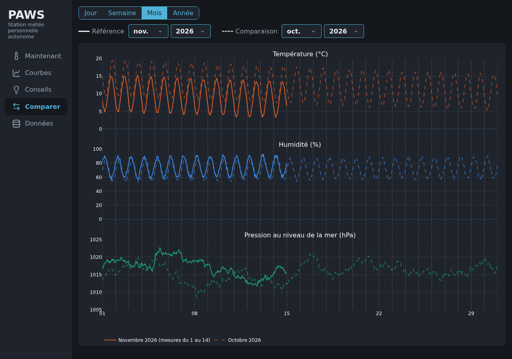

# B2 · Compare {.unnumbered}

The fourth tab of the dashboard, **Comparer** (Compare), draws two periods over each other (BF6 · Compare periods): this November against October, or this week against the previous one. The two curves start at the same place on the left of the graphs, so that the same moment of each period is drawn at the same place: the 10th of each month, or the Tuesday of each week.

The tab needs the width of a computer: on a phone, it is left out of the bar at the bottom of the screen.

> **Ready-to-use project:** The complete code of this step is available in the repository here: [`backend/paws`](https://github.com/wg1d/personal-autonomous-weather-station/tree/v1.2.1/backend/paws)

## The tab

- **The unit**: Jour, Semaine, Mois or Année (day, week, month or year). When it changes, the tab compares the current period with the one before: today with yesterday, this month with the last one.
- **The reference and the comparison**, each chosen in short lists: the day, the month and the year for a day; the week number and the year for a week; the month and the year for a month; the year for a year. Comparing October 2026 with October 2025 only needs to change the year of the comparison.
- **The graphs**: the reference in solid lines, the comparison in the same colors, paler and dashed. The marks before the lists show which line belongs to which period, and the legend names them, such as "Novembre 2026" and "Octobre 2026".

**The time axis gives the place in the period**, the same for both periods: the hour of a day, the day of a week, the day of a month (01, 08, 15…), the month of a year. Dates would be those of the reference only: the dashed curve of October drawn above "29 nov." reads as November.

**The legend tells when a period is only partly measured**, such as "Novembre 2026 (mesures du 1 au 14)": the current month is not over, and the first month of a station starts the day it was switched on. Without it, a curve that stops in the middle of the graphs looks like a gap in the data. Each period is measured over its own length: October has 31 days, even when it is drawn over the 30 days of November.

As in the Courbes tab, dragging the graphs and turning the mouse wheel move and zoom in time: both periods move together, so that the gap between them stays the same. The legend then gives the exact times shown, such as "05 sept. 2026 → 06 oct. 2026". The lists keep the periods chosen: choosing a period again brings the graphs back to its start.

## The code

The Compare tab is a part of `dashboard.py`, shown in the [first chapter](02-1-now.qmd#the-code). The page keeps the two periods compared in a `dcc.Store`: the unit, the length shown, the start of each period, and whether they are still the periods chosen in the lists.

**Choosing the periods.**

- `unit_start()` and `unit_length()` give the first day and the length of a day, a week (from Monday), a month or a year.
- `start_of()` turns the values of the lists into the first day of a period. A month has 28 to 31 days, and a year 52 or 53 weeks: the 31st of February is the last day of February, and the week 53 of a year of 52 weeks is its last week.
- `compare_dates()` turns the first days of the two periods into the periods compared. The graphs show the length of the reference: a comparison of 31 days is drawn over the 30 days of November, and its last day falls beyond the axis.

**Drawing them.** `build_comparison()` reads the data of each period at the same resolution, then moves the points of the comparison so that it starts where the reference starts (`moved()`): the comparison is drawn on the time axis of the reference. `figure()`, the same function as for the Courbes tab, then draws the curves of the comparison paler and dashed. The labels of the time axis come from `COMPARE_TICKS`, a format for each unit, such as `%d` for the day of a month; `coverage_text()` writes the measured part of a period in the legend.

**Moving them.** The limits of the drag are computed on the axis of the reference: from the first data of either period to the last. A drag stops only where both periods run out of data. Stopping where either one does would leave no room to move with a young station: comparing November with an October measured from the 28th only, the graphs could not move at all, and went back to the periods chosen at each drag.

After a drag or a zoom, `compare_after_move()` moves both starts by the same distance, and sets the new length shown.

**The callbacks.** `choose_periods()` is called when the unit or a list changes, and after a drag or a zoom; `update_comparison()` then draws the graphs. The lists are not changed after a move: Dash would take their new values for a new choice, and bring the graphs back to the start of the periods.

## The tests

The tests of the Compare tab, in `test_dashboard.py`, check that:

- any value of the lists gives the right first day, including the 31st of February and the week 53;
- October 2026 and December 2025 are drawn over each other: a row one hour after the start of each month is drawn at the same place, and the legend says that each month was measured on its first day only;
- the time axis gives the day of the month, without the dates of the reference;
- a month measured from the 28th to the 31st says so, a month measured whole says nothing;
- after a drag, both periods have moved by the same distance, and the legend gives the exact times shown.

## Speed on the server

With three years of made-up data and the code of v0.9.0, the server built the comparison of two months in 0.65 s, and of two years in 2.6 s: two years of daily values are read for each period, with a margin on each side to drag into.

## Troubleshooting

| Symptom | Cause and fix |
|---------|---------------|
| One of the curves is empty | No row in that period: the station was not running yet, or its clock was not reliable. The legend then says nothing about its measures. |
| A curve stops in the middle | The period is only partly measured: the legend gives the days measured. |
| The graphs no longer show the periods chosen | They were dragged or zoomed: choose a period again in the lists to come back to its start. |
| The tab is missing | On a phone, it is left out: open the dashboard on a computer. |

## Next Steps

The [last tab](02-5-data.qmd), Données, exports the measurements as a CSV file (BF5), shows the last backup, and receives the files downloaded from the maintenance page of the station (BF7).
