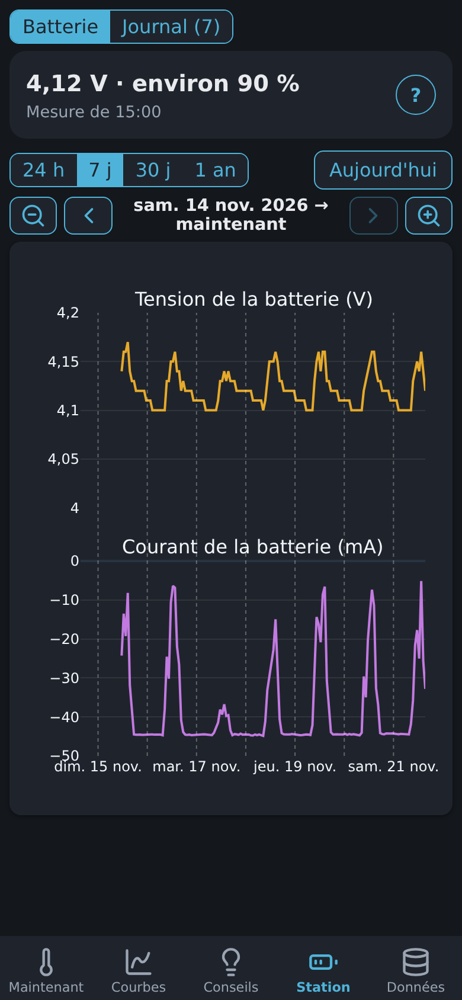
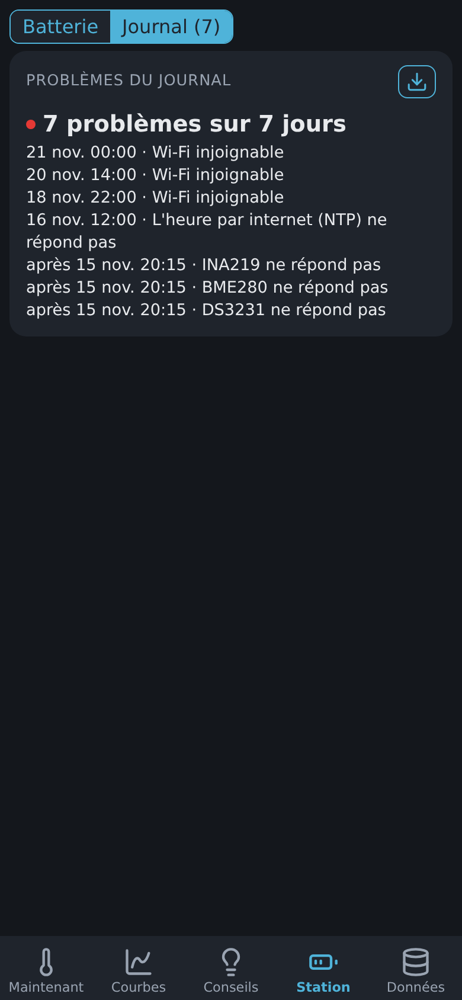
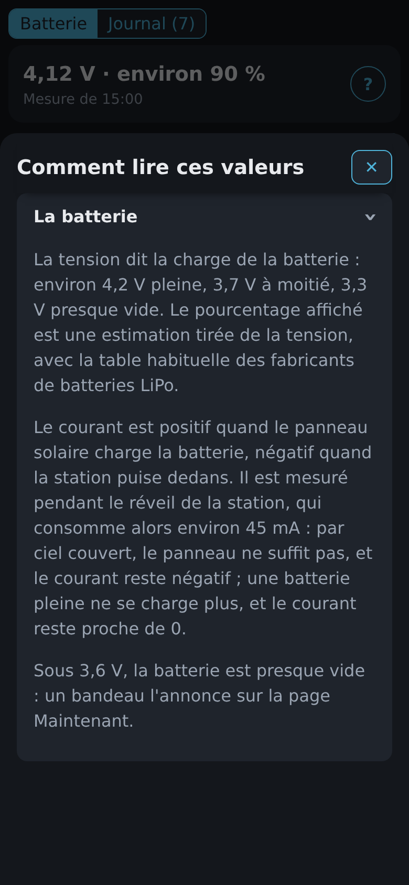

# B2 · Station {.unnumbered}

The [battery monitor](../Outdoor/07-battery-monitor.qmd) sends the voltage and the current of the battery with each row, and the log of the station tells what went wrong (see [O7 · Field Fixes](../Outdoor/08-field-fixes.qmd)). The fourth tab of the dashboard, **Station**, shows both: the health of the station itself, after the weather it measures.

> **Ready-to-use project:** The complete code of this step is available in the repository here: [`backend/paws`](https://github.com/wg1d/personal-autonomous-weather-station/tree/v1.1.0/backend/paws)

## The tab

A choice at the top of the tab, **Batterie | Journal**, shows one view at a time: each one fits on the screen of a phone without scrolling, and the log is not missed below the graphs. When the log tells problems, their number is written in the name of its view, such as *Journal (7)*.

::: {layout-ncol=2}
{width=280}

{width=280}
:::

### The battery

- **The tile**: the voltage of the battery, its estimated charge, and the time of the measurement. Its help button `?` opens the help of the tab, which explains how to read the voltage and the current:

{width=300}

- **The graphs** of the voltage and of the current, with the controls of the [Courbes](02-2-graphs.qmd) tab: 24 hours to a year, the arrows, the zoom, a drag. Both tabs show the same period: choosing 7 days in one chooses it in the other.

The week above tells the story of the [first week](../Outdoor/07-battery-monitor.qmd#the-first-week) of the battery monitor. Each day, the voltage rises in the afternoon, when the panel charges, and comes back to 4.10 V at the end of the night. The current stays near −45 mA at night, the station awake at each reading, and rises towards 0 in the day, when the panel feeds the station. A full battery is not charged further: the current rarely goes above 0.

### The charge

The charge is read from the voltage, with the usual table of the makers of lithium polymer batteries, from 3.27 V (empty) to 4.20 V (full), with straight lines between its points (`LIPO_CHARGE`, `battery_charge()`). It is an **estimate**: the voltage also depends on the current, on the temperature and on the age of the battery, and the station measures while it is awake, about 50 mA, a little below the voltage at rest.

Below 3.6 V, about 5 % of the charge, the Now tab shows an amber warning (`BATTERY_LOW_V`, our limit). The charge also appears in the status line of the [Now](02-1-now.qmd#the-now-tab) tab, after a small battery icon.

### The log

The view **Journal** lists the problems of the last 7 days found in the log of the station, the newest first, in a box that scrolls. A small button downloads the whole log.

A problem is a line of the log that holds one of the words of the messages of the firmware (`logs.PROBLEMS`): a sensor that does not answer, a measurement that timed out, a file that cannot be written, the Wi-Fi or the NTP server not reached, the reason of a restart, an I2C bus held low, or an answer of the server that is not a success. `problem_text()` turns the known ones into French:

| In the log | On the dashboard |
|------------|------------------|
| `BME280 not responding` | BME280 ne répond pas |
| `Wi-Fi not reachable` | Wi-Fi injoignable |
| `NTP not answering` | L'heure par internet (NTP) ne répond pas |
| `restart: brownout, the voltage fell` | Redémarrage : chute de tension |
| `I2C bus held low (SDA low, SCL high): freeing it` | Bus I2C bloqué (SDA bas, SCL haut) : débloqué par la station |
| `I2C bus still held low after 9 clock pulses` | Bus I2C toujours bloqué après 9 impulsions : vérifiez les câbles et l'alimentation |

Each problem has the time of its entry. An entry written while the clock of the station was not set starts with a time of 1970: it takes the time of the entry before it, written *après* (after) it, as for the three silent chips of the evening of 15 November above.

The problems of the last 24 hours also show the amber warning of the Now tab, which a cross closes until a new problem comes (see [the Now tab](02-1-now.qmd#the-now-tab)).

## The code

The Station tab is a part of `dashboard.py`, shown in the [first chapter](02-1-now.qmd#the-code), and of `logs.py`:

```{.python include="../../_versions/v1.1.0/backend/paws/paws_server/logs.py"}
```

- **`read_tail()`** reads the end of the log only, cut at the start of an entry: the log grows by about 33 KB a day on our server, and 7 days of it fit in 256 KB. The Now tab reads less, 64 KB, for its last 24 hours.
- **`problems()`** finds the problem lines, with the time of their entry. It only reads the time of an entry that holds a problem: reading a date takes a while on the small computer of the server, and a week of log holds about 700 entries.
- **`log_problems()`** keeps those of the last days, and turns them into French (`problem_text()`).
- **`battery_tile()`** writes the tile of the battery, from `database.last_row(connection, "battery_v")`, the last row that has a value for the battery.
- **The graphs** are those of the Courbes tab: `figure()` takes the list of the quantities to draw, here `BATTERY_QUANTITIES`, the voltage and the current, with their own steps for the scale (0.1 V and 50 mA).

The callback `show_station()` fills the tiles when the tab is shown and at each refresh. The problems found are kept until the log changes, which only happens at the hourly upload of the station: the size and the time of the file tell it. Opening the tab then costs about 0.2 s on the server, against 0.7 s when the log has to be read again.

The help button of the tab opens the same help sheet as the Now tab, with its own blocks only: each block is marked for the tab whose help shows it (`STATION_EXPLANATIONS`), and the style hides the others.

## The tests

`test_station.py` checks:

- **the charge**: the points of the table, a voltage between two of them, and the limits;
- **the tile of the battery**: the voltage, its charge and its time; without the INA219, *Pas encore de mesure*;
- **the problems of the log**: the problem lines found, the time of the entry before for an entry dated 1970, their French, the newest first, and every problem listed;
- **the end of the log**: read from the start of an entry, the whole log when it is short, nothing when no entry starts in it;
- **the warning of the Now tab**: the air sensor, a low battery, recent problems; a new problem changes its reasons, and shows it again;
- **the I2C bus**: a bus freed and a bus still held, in French.

## Troubleshooting

| Symptom | Cause and fix |
|---------|---------------|
| *Pas encore de mesure* | The station does not send the battery yet: its firmware is older than version 1.1.0, or the INA219 does not answer (see [O6 · Battery Monitor](../Outdoor/07-battery-monitor.qmd#troubleshooting)). |
| The current never goes above 0 | The battery is full: the charger no longer charges it, and the panel feeds the station. |
| The charge drops by 5 % at each reading | The voltage is read under the load of the awake station: the charge is an estimate. Look at its trend over the days. |
| The same problem stays in the list | It stays 7 days: the list is a history, not the state of the moment. |
| A problem appears once with *après* | Its entry was written while the clock of the station was not set: see [O7 · Field Fixes](../Outdoor/08-field-fixes.qmd). |

## Next Steps

The [next chapter](02-4-compare.qmd) describes the Comparer tab, which draws two days, weeks, months or years over each other.
