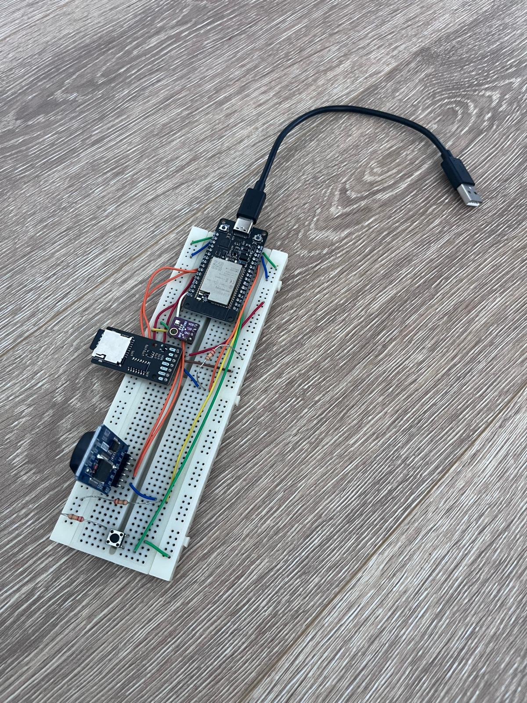
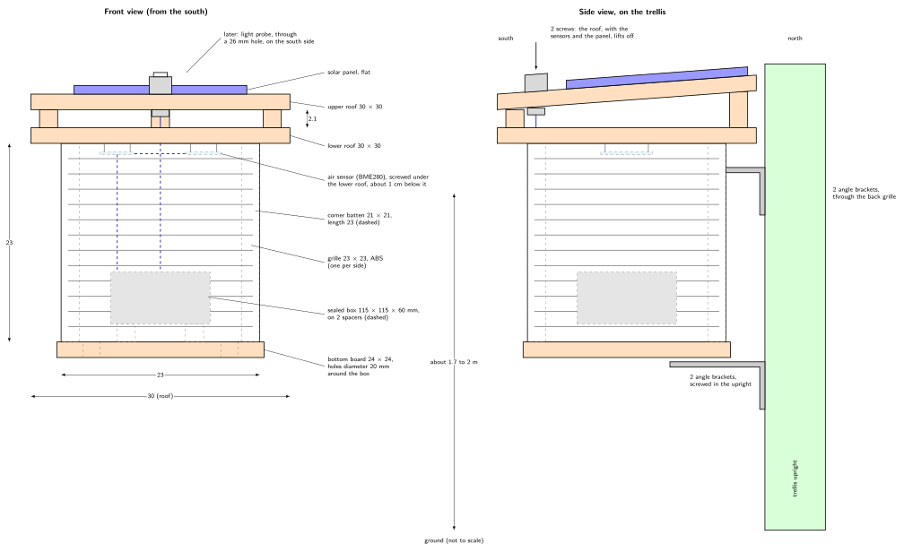
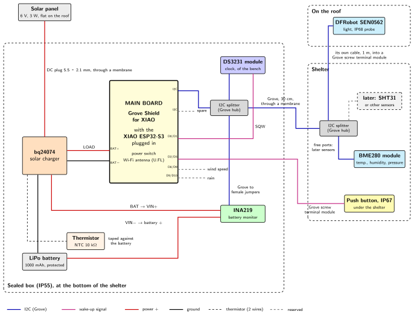

# Outdoor Station Design {.unnumbered}

Until now, the station lives on a breadboard, on a desk, powered by a USB cable. The forecasting of a later phase needs months of real measurements, made outdoors: the station must first leave the desk. This chapter designs the outdoor station before anything is bought or soldered: what it must do, its components, how they connect, its shelter, and the steps that build it. Its power, from the solar panel to the battery monitor, has a [chapter of its own](01-power.qmd).

{width=400}

The design follows the same pattern as those of the [firmware](../Architecture/Phase-04/00-1-requirements.qmd) and of the [backend](../Backend/00-design.qmd): requirements first, then the choices that meet them.

::: {.callout-note}
This chapter is a first version: the choices below are proposals, to be confirmed before anything is ordered. The prices are those of the shops linked, in euros, at the time of writing, without the shipping costs.
:::

## Requirements

The identifiers start with **H**, for hardware.

### Functional requirements

| ID | Name | Requirement | Why |
|----|------|-------------|-----|
| H1 | Outdoor air | Measure the temperature and the humidity of the outdoor air in a ventilated shelter, in the shade, between 1.25 and 2 m above the ground, as recommended by the World Meteorological Organization; measure the pressure. | In the sun, a sensor measures its own heating, not the air. The height follows the practice of official weather stations. |
| H2 | Own power | Run all year, winter included, from a solar panel and a battery, without a socket. | There is no socket in the garden. |
| H3 | Power monitoring | Measure the voltage of the battery and the current that charges or discharges it, and send them with the measurements. | To see a power failure coming, and to learn the real behavior of the battery. |
| H4 | Garden range | Upload from the garden, about 30 m from the Wi-Fi access point, and log the strength of the Wi-Fi signal (RSSI). | The range decides where the antenna goes. |
| H5 | More sensors | Add the light, the UV, the wind, the rain and the soil moisture later, without a printed circuit board, with their place already reserved. | A weather station grows one sensor at a time. |
| H6 | Serviceable | Start the maintenance mode without opening anything, and replace every module on its own. | The maintenance page must stay usable on site. |

### Non-functional requirements

| ID | Name | Requirement |
|----|------|-------------|
| HN1 | Weatherproof | Resist rain and condensation: the electronics in a sealed box, itself sheltered from the rain. |
| HN2 | Temperature range | Run from −15 °C to +45 °C, and never charge the battery below 0 °C, which damages a lithium battery. |
| HN3 | Simple tools | Build with simple tools: wood (battens, boards), screws, white paint, a drill; solder only pin headers and a few wires; no printed circuit board, no 3D printer. |
| HN4 | Low cost | Keep the cost as low as possible, and prefer cheaper parts when they meet the requirements. |
| HN5 | No loose wires | No jumper wires between modules: every link is a cable with connectors at both ends (Grove, JST), and power wires go into screw terminals. |

## What 3D-PAWS does

[3D-PAWS](https://3dpaws.comet.ucar.edu/), the 3D-printed weather station of UCAR, solves the same problems, and publishes its [parts list](https://docs.google.com/spreadsheets/d/10M0B0uvYnA0v-_q23aUk9Q1RNNS-oWH9inRZntQyyuM/edit?usp=sharing). Several of its choices guide this design:

- **one sensor per quantity**, rather than a combined one: an MCP9808 for the temperature, an SHT31-D for the humidity, a BMP390 for the pressure;
- **connectors instead of wires**: the sensors plug into a hub with cables of the Grove system, whose 4-pin connectors lock;
- **a magnetic rotation sensor on the I2C bus** (AS5600) for the wind direction, and magnetic switches for the wind speed and the rain;
- **a 6 V solar panel** and a battery, in a waterproof box.

## Overview

The outdoor station is a small wooden shelter, screwed on a wooden garden trellis. Everything is in it or on it:

- **The walls** are four louvered vent grilles: the air goes through, the sun and the rain do not.
- **The electronics** are in a sealed box at the bottom: the board, the clock, the battery, its charger and its monitor.
- **The air sensors** (temperature, humidity, pressure) are screwed under the roof, in the middle of the shelter, away from the walls and from the box.
- **On the roof** lies the solar panel; a waterproof light probe can join it later.
- **The roof is the lid**: two screws hold it, and it lifts off with the sensors and the panel.

## The microcontroller: XIAO ESP32-S3

The station needs a smaller and more frugal board than the development board of the bench, which stays on the desk for tests. The [Seeed Studio XIAO ESP32-S3](https://wiki.seeedstudio.com/xiao_esp32s3_getting_started/) suits it:

| | XIAO ESP32-S3 | Adafruit ESP32 Feather V2 |
|---|---|---|
| Deep sleep current | 14 µA | 70 to 100 µA |
| External antenna | Included (U.FL connector) | Connector only, antenna sold apart |
| Size | 21 × 17.8 mm | 51 × 23 mm |
| Memory for programs and files (flash) | 8 MB | 8 MB |

- Its **deep sleep current** is five times lower, and the station sleeps more than 99 % of the time.
- Its **external antenna** is included: it helps for the 30 m to the access point (H4).
- It belongs to the same family of chips as the current board (ESP32-S3 instead of ESP32): it wakes up on a pin or a timer in the same way, and the firmware keeps its architecture; only the pins and the build environment change.
- It is sold with its two rows of 7 pins already soldered, ready to plug into the board below.

### The Grove Shield

The XIAO plugs into a [Grove Shield for XIAO](https://wiki.seeedstudio.com/Grove-Shield-for-Seeeduino-XIAO-embedded-battery-management-chip/): a small board with female headers for the XIAO and **8 Grove connectors**, each giving two pins of the XIAO, its 3.3 V and its ground. Every module of the station connects to it with a cable.

| Grove connector | Pins | Use |
|-----------------|------|-----|
| I2C (first) | D5 (SCL), D4 (SDA) | I2C bus: all the modules, through two hubs |
| I2C (second) | D5, D4 | Free |
| D0/D1 | D0 | Alarm of the clock: wakes the station up |
| D2/D3 | D2 | Maintenance button: wakes the station up |
| D8/D9 | D8 | Reserved: wind speed |
| D9/D10 | D9 | Reserved: rain |
| D7/D6 (UART) | — | Free |

A pin that wakes the station up must be one of the pins that stay powered in deep sleep, the *RTC pins*: on the ESP32-S3, these are GPIO 0 to 21, which include D0 to D10 of the XIAO, but not D6 and D7.

The Grove Shield also receives the power of the solar charger on its battery pads, and gives the 3.3 V of the XIAO and of the modules (see [Power](01-power.qmd#from-the-charger-to-the-board)).

Under the Grove Shield, small spring contacts touch pads under the XIAO, to debug the XIAO boards built around an ARM chip with a probe (SWD). The ESP32-S3 is programmed and debugged through its USB port instead: these contacts are not used, and the rest of the Grove Shield works with it.

## Storing the measurements

The outdoor station has **no SD card**: the measurements are kept in the flash memory of the XIAO, in a file system.

- A row, with the new quantities of this phase, takes about 80 bytes; one measurement every 15 minutes makes 96 rows a day, about **2.8 MB a year**.
- Of the 8 MB of flash, about 5 MB remain for the files once the firmware is installed: **close to two years** of measurements, and the log.
- When the memory fills up, the station deletes its oldest rows, only those the server has acknowledged. The server keeps them, and [backs them up](../Backend/03-1-operations.qmd) every night.

Without an SD card, there is no card reader to wire and to power, and no card to wear out outdoors. The [maintenance page](../Architecture/Phase-04/05-1-maintenance-mode.qmd) still gives the files, to retrieve the data with a phone when the station cannot reach the Wi-Fi.

## The sensors

| Quantity | Sensor | Why |
|----------|--------|-----|
| Temperature, humidity and pressure | **BME280** module, the one of the bench | It measures the three quantities: ±1 °C, ±3 % RH, ±1 hPa |
| Battery | **INA219** module | Voltage and current of the battery (see [Power](01-power.qmd#the-battery-monitor)) |
| Time | **DS3231** module, the one of the bench | Its alarm wakes the station up |
| Light, UV, wind, rain, soil | Reserved for later steps | See [Later sensors](#later-sensors) |

The station starts with the BME280 and the clock of the breadboard. A **SHT31** (±0.3 °C, ±2 % RH, the sensor of 3D-PAWS) can later replace the BME280 for the temperature and the humidity, about three times more accurate: it plugs into the same hub.

All of them are on the **I2C bus**, where each one answers at its own address: 0x76 or 0x77 (BME280, depending on the module), 0x40 (INA219), 0x68 (DS3231) and 0x57 (the memory chip of the DS3231 module).

### The clock

The DS3231 module keeps the time with a coin cell, and wakes the station up with its alarm, on its SQW pin. The common module, named ZS-042, was designed for an Arduino at 5 V with a rechargeable coin cell. On the station, its **power LED** is removed: it stays lit as long as the module is powered, and draws more than the rest of the sleeping station. Its charging circuit, harmless at 3.3 V, stays. The [DS3231 Module](../Appendix/04-ds3231-module.qmd) appendix explains both, and how to remove the LED.

### Later sensors

| Quantity | Proposed | Connection |
|----------|----------|------------|
| Light | DFRobot SEN0562, a waterproof probe | I2C, address 0x23 (see [The light probe](#the-light-probe)). |
| UV | LTR390 | I2C. No UV sensor on the I2C bus is sold ready to go outdoors: it needs a small box with a PTFE window, which lets the UV through, unlike the usual clear plastics. |
| Wind speed, rain | Anemometer and tipping-bucket rain gauge, both closing a contact | Each closing is a pulse to count while the station sleeps: either by a counter on the I2C bus (PCF8583), read at each wake-up, or by the low-power coprocessor (ULP) of the ESP32-S3, on D8 and D9. |
| Wind direction | AS5600, as 3D-PAWS | I2C |
| Soil moisture | Capacitive sensor on the I2C bus | I2C. The STEMMA soil sensor of Adafruit uses the address 0x36, as the AS5600: a jumper changes it. |

### The light probe

The light comes in a later step, together with the UV, with this probe.

The [SEN0562 of DFRobot](https://wiki.dfrobot.com/sen0562/) is a BH1750 light sensor in a waterproof probe (IP68), with a 1 m cable. It measures from 1 to 65,535 lux, and draws about 1 µA. It will be screwed through a 26 mm hole in the upper board of the roof, on the south side, where the panel never shades it.

DFRobot gives it a 5 V supply, while the Grove connectors give 3.3 V. Its BH1750 chip itself works from 2.4 to 3.6 V, and the probe is reported to work at 3.3 V: this will be checked on the bench before it is mounted.

The connector at the end of its cable will be cut off, and its four wires screwed into a **Grove module with screw terminals**: a Grove connector on one side, four screw terminals on the other (VCC, GND, and the two signals of the connector), which hold bare wires. Red goes to VCC, blue to GND, yellow (SCL) to the first signal terminal, green (SDA) to the second.

## Connections

Every link is a cable with connectors at both ends, or a wire held by a screw terminal (HN5):

- **The I2C bus** goes from the Grove Shield to a **Grove I2C hub** in the sealed box, a small board that repeats the bus on 6 connectors: the clock and the battery monitor plug into it. A 30 cm Grove cable goes out of the box to a second hub, in the shelter, for the BME280; its free connectors wait for the later sensors.
- **The clock, the BME280 and the INA219** have pins, not Grove connectors: each one connects to its hub with a cable that has a Grove connector at one end and four female connectors at the other, which plug onto the pins of the module.
- **The alarm of the clock** comes with a Grove to female connectors cable, from the D0/D1 connector: its yellow wire plugs onto the SQW pin of the clock, its black wire onto GND.
- **The maintenance button** is a waterproof push button (IP67), mounted through the bottom board of the shelter and pointing down: it is pressed from below, without opening anything (H6), and the rain does not fall on it. It closes its contact only while it is pressed. Two male-to-male jumper wires go from its screw terminals into a Grove to female connectors cable on the D2/D3 connector, and close D2 to the ground.
- **The power wires** go through JST connectors, screw terminals and a lever connector (see [Power](01-power.qmd#wiring)).

The I2C bus is about 1 m long, and grows with each later sensor: the firmware uses a lower clock rate, 100 kHz or below, which keeps a long bus reliable.

### What is soldered

Only a few wires (HN3):

- the **pin header and the screw terminal** of the INA219 module, supplied apart;
- **two wires on the battery pads** of the Grove Shield, which bring the power of the solar charger;
- the **thermistor** on the solar charger, and the **battery plug** (see [Power](01-power.qmd#wiring));
- on the clock module, the **power LED** to remove.

## Wi-Fi range

The XIAO comes with an external antenna, which stays in the sealed box: plastic and wood let the Wi-Fi through. Before anything is bought, the [Wi-Fi signal test](../Appendix/03-wifi-signal.qmd), run on the development board at the place of the station, shows the strength of the signal every second, and tells whether this antenna is enough.

At the place chosen for the station, the test measured about −68 dBm, and −74 dBm at the weakest, with the development board: a good signal, since the station only sends a few rows at a time. The XIAO, with its external antenna, receives at least as well: no extra antenna and no repeater are needed.

## The shelter

A Stevenson screen, the shelter of official weather stations, keeps the sensors in the shade and in moving air. This one is built from vent grilles and pine, with simple tools.

- **The walls**: four louvered vent grilles in ABS, 23 × 23 cm, screwed on four corner battens of 21 × 21 mm, cut to 23 cm. ABS turns yellow and brittle in the sun over the years: a coat of white paint for plastics protects it.
- **The bottom**: a board of 24 × 24 cm, drilled with holes of 20 mm around the box, so that the air also comes in from below, and with a hole of 16 mm for the maintenance button, which points down.
- **The double roof**: two boards of 30 × 30 cm, separated by spacers cut from the batten. In the sun, the upper board heats up, the more so under the solar panel; the air that goes between the two boards takes this heat away, and the lower board stays close to the temperature of the air. The upper board leans to the south, on one spacer at the front and two stacked at the back: the rain runs off away from the trellis.
- **The lid**: the lower board of the roof, with everything on it, is held by two wood screws in two opposite corner battens.
- **The air sensors** are screwed under the lower board, on two M3 screws, with nuts as spacers of about 1 cm: they touch no wall, and the air goes all around them.
- **On the upper board**: the solar panel, flat. The light probe will join it later, on the south side; its cable will go down through a small hole of the lower board, sheltered by the upper one.
- **The sealed box**: a junction box of 115 × 115 × 60 mm (IP55), on two spacers at the bottom. Its cables go through the rubber membranes of its entries, at the bottom of the box; around a thin cable, a turn of self-amalgamating tape, which fuses into a watertight sleeve, closes the passage. A bag of silica gel absorbs the condensation.
- **The support**: a wooden garden trellis, about 1.65 m high, standing in a planter, 3 m from a wall. The shelter is screwed on a vertical upright of the trellis, not on its thin slats: with the panel on its roof, it catches the wind. Two angle brackets carry the bottom board, two more hold the top of the back battens, screwed through the back grille. The sensors are at about 1.7 to 2 m, within the usual height of weather stations.
- **The climbing plant** of the trellis stays a few tens of centimetres below the shelter, and is trimmed so that it never grows into it: plants release humidity and cool the air around them. Watering the planter can also raise the humidity measured for a while.

All the wood is painted white, which reflects the sun.

## Data and firmware

The outdoor station changes the software in four ways:

- **new adapters**: the BME280 (already written for the bench station, with new pins), the INA219, the maintenance button on its new pin, and the pins of the XIAO, in a new build environment. The state machine does not change: this is what the [ports and adapters](../Architecture/Phase-04/00-4-structure-and-verification.qmd) were designed for;
- **the storage** moves from the SD card to the flash memory, and deletes the oldest acknowledged rows when it is full;
- **new columns**: battery voltage, battery current, and the strength of the Wi-Fi signal. The CSV format and the upload protocol move to a version 2, and the backend learns it, while still accepting the version 1;
- **the dashboard** shows the new quantities, and the state of the battery.

## Parts and cost

Most of the electronics come from a French shop, [Gotronic](https://www.gotronic.fr), which sells the Seeed Studio, Adafruit and DFRobot boards. Amazon has two parts for less: a solar panel with the plug of the charger, and a generic INA219 module. The BME280, the DS3231 module and the USB-C cable are those of the bench. The wood, the grilles and the sealed box come from a DIY store.

The electronics and the cables cost **about 95 €**, without the shipping costs and the parts of the bench station: about 69 € at Gotronic, and 26 € at Amazon. The [parts list](02-parts-list.qmd) gives every part to buy, shop by shop, with its link and its price, including the parts of the bench station.

## Implementation plan

| Step | Content |
|------|---------|
| O0 | Wi-Fi range: the [Wi-Fi signal test](../Appendix/03-wifi-signal.qmd), run in the garden, tells whether the antenna is enough. Done: see [Wi-Fi range](#wi-fi-range). |
| O1 | Parts: final list, order. |
| O2 | Bench: the solderings, and the modules connected with their cables on the desk. |
| O3 | Firmware: the XIAO, the new sensors, the battery monitor, the flash storage; protocol version 2, and the backend. |
| O4 | Shelter: wood, grilles, paint, mounting. |
| O5 | Outdoors: installation, first measurements, and the start of the data collection. |
