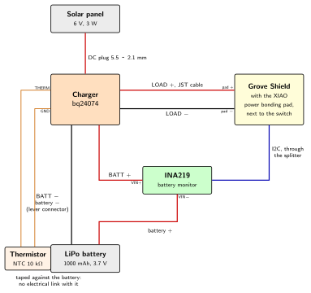

# Outdoor Station Power {.unnumbered}

On the desk, the station draws its power from a USB cable. In the garden, there is no socket (H2): the station lives on a battery, which a solar panel charges during the day. This chapter explains how this works, from what the station consumes to the battery monitor that reports its state with every measurement. The [design chapter](00-design.qmd) gives the list of the parts and how they connect.

The **solar panel** charges the **battery** through the **charger**; the charger powers the **Grove Shield**, the board that carries the XIAO; the **battery monitor** (INA219), on the + wire between the charger and the battery, measures what goes in and out. The **thermistor** is taped against the battery, but wired to the charger only.

## What the station consumes

Everything starts from the consumption of the station: it sets the size of the battery and of the panel.

The [energy estimate](../Architecture/Phase-04/06-3-energy-and-review.qmd) of the current firmware gives an average current of **0.24 to 0.43 mA**, with the development board of the bench. The outdoor station adds a few permanent currents, taken from the datasheets of its parts:

| Part | Current while the station sleeps |
|------|----------------------------------|
| Grove Shield: its charger and its 3.3 V converter | about 35 µA |
| bq24074 charger, at night, without sun | about 4 µA |
| INA219, in power-down mode | about 6 µA |

These add about 0.05 mA. On the other side, the XIAO sleeps with 14 µA, much less than the development board. All in all, the station should draw **about 0.3 to 0.5 mA on average, 7 to 12 mAh a day**. These figures are estimates from datasheets: the battery monitor gives the real behavior of the station once it is outdoors.

## The battery

A lithium-ion battery stores the energy for the night and for the days without sun. The station uses an **18650 cell**, the cylindrical cell of laptop batteries and flashlights, 18 mm in diameter and 65 mm long:

- **3.7 V nominal**: 4.2 V when full, about 3.0 V when empty;
- **2600 mAh**: with 12 mAh a day, it would hold **more than six months without any sun** on paper. Winter reduces this: a lithium battery gives less of its capacity in the cold. The margin stays very large;
- **protected**: a small circuit at the end of the cell disconnects it when its voltage falls too low, when it is overcharged, or on a short circuit. An empty lithium cell, discharged further, is damaged for good: the protection prevents it, even if everything else fails.

The cell sits in a **holder** with two wires.

### Lithium and the cold

A lithium battery can **power** the station in the cold, down to about −20 °C, with less capacity. It must not be **charged** below 0 °C: in the cold, the lithium that comes back into the negative electrode during the charge deposits on its surface as metal, instead of going inside it. Each such charge loses a little capacity for good, and the deposits can end up short-circuiting the cell.

In winter, a sunny morning can follow a night of frost: the panel gives current while the battery is still below 0 °C. The charger must therefore know the temperature of the battery, and wait until it is above 0 °C (HN2).

## The solar panel

The panel turns light into current. It is described by two values, measured in full sun (1000 W per square metre):

- its **voltage**, 6 V: it must be higher than the voltage of the full battery, 4.2 V, with a margin, for the charger to work;
- its **power**, 3 W: about 0.5 A at 6 V in full sun.

The panel lies **flat on the roof** of the shelter. A flat panel receives less light than a panel facing south, tilted, mostly in winter, when the sun stays low: in December, about two to three times less. Even so, the margin is large. In December, in France, a horizontal surface receives on average roughly 0.6 kWh of sunlight per square metre per day in the north, and up to about 2 kWh in the south: the same energy as 0.6 to 2 hours of full sun. A 3 W panel then gives about 2 to 6 Wh a day. Even if half of it is lost, in the charger and on grey days, 1 Wh is about **250 mAh** at the voltage of the battery: twenty times the 12 mAh the station needs.

## The charger

A lithium battery is never connected directly to a panel: the charger stands between them. The station uses the [Adafruit bq24074](https://learn.adafruit.com/adafruit-bq24074-universal-usb-dc-solar-charger-breakout), which does four things.

1. **It charges the battery safely**: first with a constant current, then, near 4.2 V, with a constant voltage while the current decreases, and it stops when the battery is full. A lithium battery charged above 4.2 V is damaged, and can catch fire.
2. **It powers the station while it charges** (*power path*): its **LOAD** output gives the station what it needs, from the panel when there is sun, from the battery otherwise. The station never stops when the sun comes or goes.
3. **It adapts to the panel**: when the light is weak, the panel cannot give much current, and its voltage drops if more is drawn. The charger then lowers its current, to keep the voltage of the panel up and to draw as much as the panel can give.
4. **It checks the temperature of the battery**, with a **thermistor**: a resistor whose value changes with the temperature, taped against the cell. With the thermistor named in its datasheet, a 10 kΩ NTC of the 103AT type, the bq24074 only charges between **0 °C and 50 °C**, with a hysteresis of 3 °C ([TI datasheet](https://www.ti.com/lit/ds/symlink/bq24074.pdf)). Outside this range, it suspends the charge, and the station keeps running on its battery.

The thermistor is a small component at the end of two wires. It has no electrical link with the battery: it is only taped against it, to take its temperature. Its two wires go to the charger: on the board of Adafruit, one is soldered to the **THERM** pad, the other to the ground, after a small jumper marked THERM is cut. The panel plugs into the DC jack of the charger, the battery and the station into its two JST connectors, LOAD and BATT. At night, without input, the charger draws about 4 µA from the battery.

Cheaper charger modules exist, built around the TP4056 or the CN3791. Their chip also has a temperature input, but on the modules sold, this input is connected to the ground, which disables it ([TP4056](https://wiki.adom.inc/ray/tp4056)): they would charge the battery in the frost. Enabling it means cutting a trace of the module and adding resistors.

## From the charger to the board

The LOAD output of the charger goes to the **battery pads of the Grove Shield**, the board that carries the XIAO. The Grove Shield has its own charger, made for a battery charged from the USB port, and a converter that gives the 3.3 V of the XIAO and of the modules. For the Grove Shield, the solar charger takes the place of its battery: its charger lets the current through to the converter. Together, they draw about 35 µA.

The charger of the Grove Shield cannot replace the bq24074: its input is made for the 5 V of a USB port and is protected by components that limit it to about 5 V, while a 6 V panel exceeds 7 V without load; and it has no thermistor input.

One rule follows: **the power switch of the Grove Shield is set to OFF before the USB cable is plugged in**, to program the XIAO. Otherwise, the charger of the Grove Shield would charge its "battery", which is the output of the solar charger.

## The battery monitor

The battery monitor is part of the station for good: at each wake-up, every 15 minutes, it measures the battery, and its values are sent with the weather measurements.

### What it measures

The **INA219** is a chip that measures a current and a voltage, read on the I2C bus. Its module carries a small resistor of 0.1 Ω, the *shunt*, through which the current flows. A current through a resistor creates a small voltage across it, 0.1 mV per mA here: the INA219 measures this voltage, and gives the current. It also measures the voltage on the side of the battery.

The INA219 is placed **between the charger and the battery**: all the current of the battery goes through its shunt. At each wake-up, it gives:

- the **voltage of the battery**, which tells its state of charge: about 4.2 V when full, 3.7 V half-way, 3.3 V close to empty;
- the **current of the battery**, with its direction: **positive** when the sun charges it, **negative** when the station draws from it.

### What it shows

On the dashboard, these two curves tell the story of the energy of the station:

- during the day, the **charging current** follows the sun: it shows whether the panel works, and when it gets dirty or covered with snow;
- at night, the **voltage** slowly decreases: its slope over the night shows the consumption of the station;
- over the weeks, the voltage at the end of the night shows whether the battery fills up again every day, or empties slowly, as can happen in December;
- a battery that ages loses its voltage faster at night than it used to.

The station can thus warn before it stops, instead of falling silent.

### Its limits

- It measures **at the moment it is read**, once every 15 minutes: a snapshot, not the energy that came in and out between two wake-ups. Counting this energy would need a *charge counter*, another chip, which stays awake all the time.
- When it is read, the station is awake: the current it measures is the current of the station **awake**, about 50 mA or more, not its sleep current.
- Its resolution is 0.1 mA, with a range of ±400 mA, which covers the panel and the awake station.

Between two measurements, the firmware puts it in power-down mode, where it draws about 6 µA according to its datasheet.

## Summary

| Part | Role |
|------|------|
| Solar panel, 6 V, 3 W | Turns the light into current, about 250 mAh a day in winter, at least |
| bq24074 charger | Charges the battery safely, powers the station, adapts to the panel |
| Thermistor 103AT | Stops the charge below 0 °C |
| 18650 cell, 2600 mAh, protected | Holds the energy: months without sun on paper |
| INA219 | Measures the voltage and the current of the battery at each wake-up |
| Grove Shield | Receives the power of the charger on its battery pads, and gives the 3.3 V |
