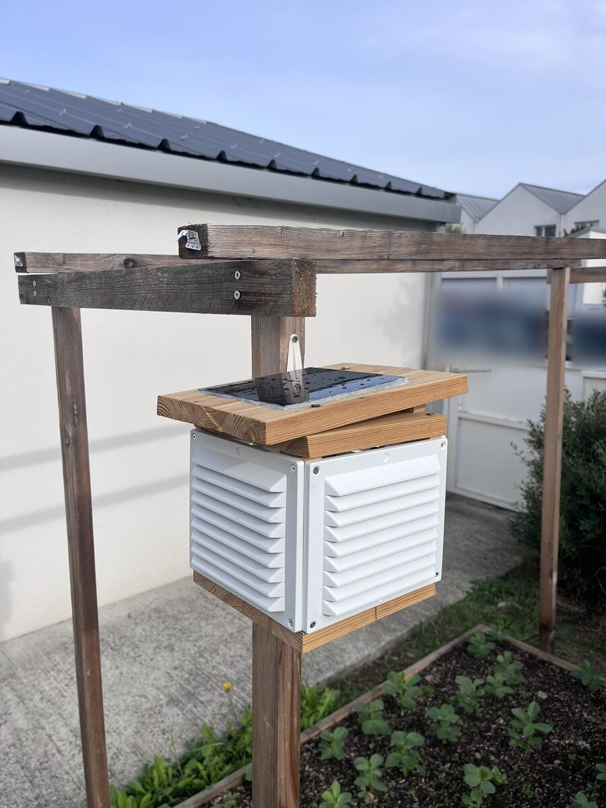

# O4 · Shelter {.unnumbered}

The shelter keeps the sensors in the shade and in moving air, and the electronics dry. It follows the plan of the [design chapter](00-design.qmd#the-shelter): four vent grilles around a small frame, a double roof, and a bottom board, on a garden trellis. This chapter shows the shelter as it was built, and where it differs from the plan.

{width=400}

## As built

- **The walls**: four white ABS vent grilles, screwed on the four corner battens.
- **The double roof**: the lower board closes the shelter like a lid; the upper board, on its spacers, leans to the south, and the air goes between the two boards.
- **The solar panel** lies flat on the upper board, glued to it.
- **The BME280** is screwed directly under the lower board, by its single mounting hole.
- **The sealed box**, with the XIAO, the charger and the battery, sits on the bottom board, inside the grilles.
- **The support**: the shelter is screwed on a vertical upright of the trellis, with angle brackets.

## Differences from the plan

- The wood is left bare, not painted white.
- The BME280 is screwed directly under the lower board of the roof, without nuts as spacers.

## Next Steps

The [next step](06-outdoors.qmd) installs the station in its shelter, switches it on, and checks that its measurements reach the server.
